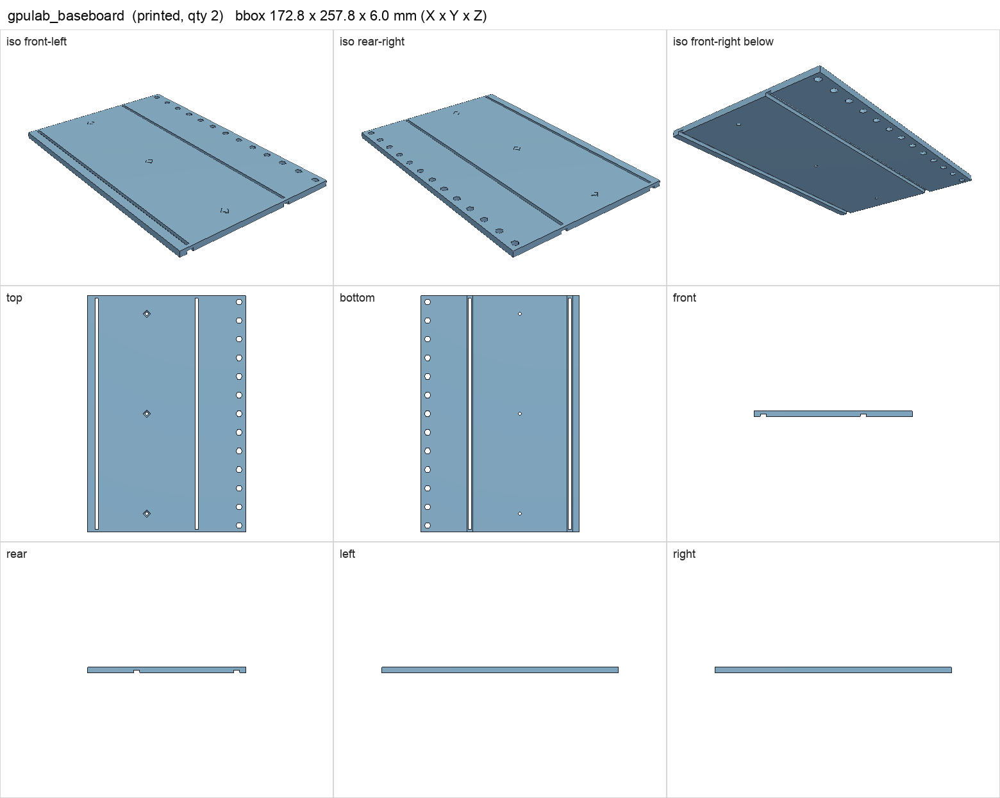
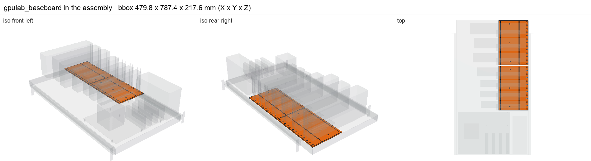

# gpulab_baseboard

<!-- Generated by make check from part.toml. Edit part.toml, not this file. -->

| | |
| --- | --- |
| ID | `gpulab_baseboard` |
| Category | printed |
| Role | 13-position GPU baseboard: post holes for the card brackets and sliding-nut channels for the MCIO riser boards |
| Status | design |
| Quantity | 2 |
| Systems | node |
| Print | plate `01_gpulab_baseboard`, PETG |

Two identical prints laid end to end along the shelf depth give 26 positions on
one continuous 20.32 mm (PCIe CEM) pitch. Each position has a hex hole for a
Wurth post base that passes through the plastic and bears on the steel deck.
The riser boards sit on M3 standoffs held by M3 nuts that slide in channels
along the plate, so a riser can go under any position. Bracket post offsets
and the bracket-to-connector distance follow the AIPC survey values and the
PCIe CEM drawing; neither is measured on a real card in this layout.

## Model

- [gpulab_baseboard.step](gpulab_baseboard.step) and [gpulab_baseboard.stl](gpulab_baseboard.stl)
- Source: generated. Exported by cad/layout.py in shelf coordinates; print/ re-orients it on the plate.
- Assembly: 2 instances in the assembly

## Datasheets

- None recorded. 

## Dimensions

| Key | Value | Evidence | Source / note |
| --- | --- | --- | --- |
| mass | 0.193 kg | allowance | OrcaSlicer filament estimate |

## Interfaces

- provides `gpu-baseboard-position` count 13 (allowance) — 13 positions per print, 26 for the two

## Compatibility checks

| Status | Rule | Interface | Detail |
| --- | --- | --- | --- |
| BLOCKED | budget | `shelf-load` | load 17.3 kg of 39.0 kg x derate 1.0 = 39.0 kg (44% of rating); unknown load for ['amd-radeon-ai-pro-r9700'] |
| provisional | count | `gpu-baseboard-position` | need 26 x gpu-baseboard-position, have 26 |

