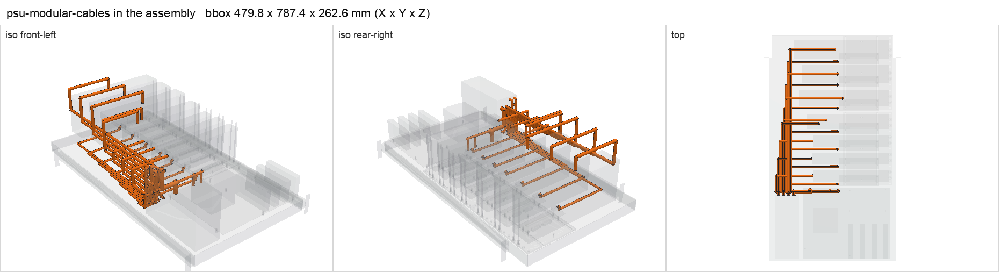

# Super Flower Leadex 2800W modular cable set (approximate routes)

<!-- Generated by make check from psu-modular-cables.toml and the library part.toml. Edit those, not this file. -->

Library spec: [parts/purchased/psu-modular-cables](../../parts/purchased/psu-modular-cables/README.md) (dimensions, interfaces, datasheets, model).

| | |
| --- | --- |
| Role | power leads from the PSU to the GPUs, riser boards and board |
| Status | candidate |
| Quantity | 1 |
| Systems | node |

## Assembly

- 18 instances in the assembly

## Compatibility checks

| Status | Rule | Interface | Detail |
| --- | --- | --- | --- |
| BLOCKED | budget | `shelf-load` | load 18.5 kg of 39.0 kg x derate 1.0 = 39.0 kg (47% of rating); unknown load for ['amd-radeon-ai-pro-r9700'] |

