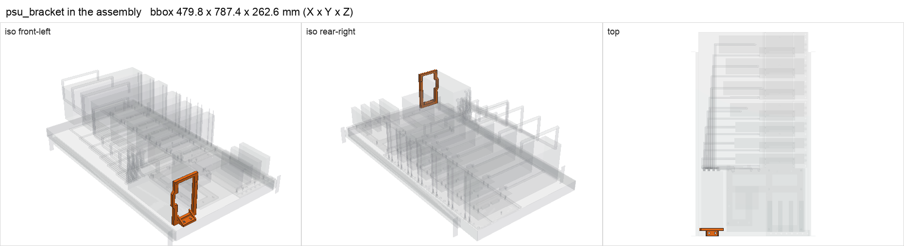

# psu_bracket

<!-- Generated by make check from psu_bracket.toml and the library part.toml. Edit those, not this file. -->

Library spec: [parts/printed/psu_bracket](../../parts/printed/psu_bracket/README.md) (dimensions, interfaces, datasheets, model).

| | |
| --- | --- |
| Role | PSU restraint on the AC face, reused from AIPC and turned 180 degrees |
| Status | design |
| Quantity | 1 |
| Systems | node |

The PSU lies on the same side as AIPC's, so the two upper rear-face #6-32 holes meet the bracket.

## Assembly

- 1 instances in the assembly

## Compatibility checks

| Status | Rule | Interface | Detail |
| --- | --- | --- | --- |
| BLOCKED | budget | `shelf-load` | load 18.7 kg of 39.0 kg x derate 1.0 = 39.0 kg (48% of rating); unknown load for ['amd-radeon-ai-pro-r9700'] |
| provisional | value | `psu-restraint` | super-flower-leadex-2800w needs ATX 150 x 86 face; provided by psu_bracket |
| provisional | count | `psu-restraint` | need 1 x psu-restraint=atx 150 x 86 face, have 1 |

