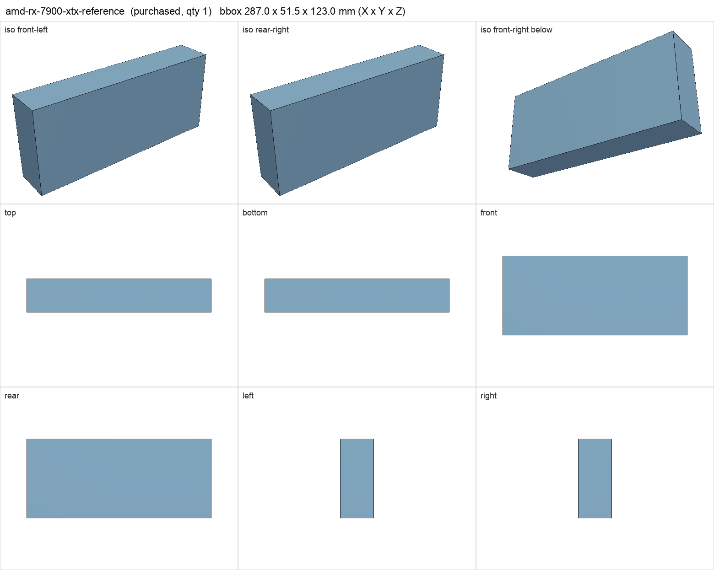
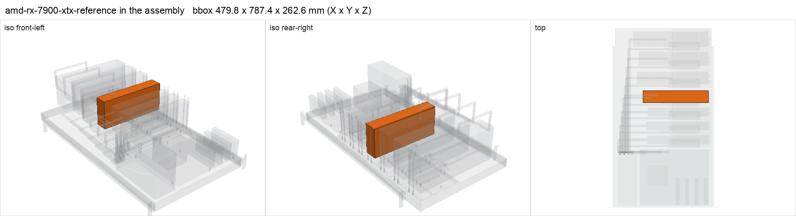

# AMD Radeon RX 7900 XTX (AMD reference)

<!-- Generated by make check from part.toml. Edit part.toml, not this file. -->

| | |
| --- | --- |
| ID | `amd-rx-7900-xtx-reference` |
| Category | purchased |
| Role | GPU under test (open-air cooler), 4 baseboard positions |
| Status | candidate |
| Quantity | 1 |
| Systems | node |
| Product | <https://www.amd.com/en/products/graphics/desktops/radeon/7000-series/amd-radeon-rx-7900xtx.html> |

Open-air, three axial fans.
Occupies 4 positions (thickness plus 15-25 mm air gap at the 20.32 mm pitch).
Running on an MCIO riser at x8; values marked review/listing are provisional.

## Model

- [amd-rx-7900-xtx-reference.step](amd-rx-7900-xtx-reference.step)
- Source: constructed. Body envelope only: length x height x thickness.
- Assembly: 1 instances in the assembly

## Datasheets

- [AMD RX 7900 XTX specifications](https://www.amd.com/en/products/graphics/desktops/radeon/7000-series/amd-radeon-rx-7900xtx.html)
- Local copies: `datasheets/` after `make datasheets` (not committed)

## Dimensions

| Key | Value | Evidence | Source / note |
| --- | --- | --- | --- |
| length | 287 mm | datasheet | AMD spec page |
| height | 123 mm | review | Tom's Hardware |
| thickness | 51.5 mm | review | Tom's Hardware; AMD: 2.5 slot |
| tgp | 355 W | datasheet | AMD TBP |
| mass | 1.81 kg | review | inferred from Club386 (XT 1.52 kg + 0.29 kg) |
| power_connector_from_tail | 40 mm | allowance | 2 x 8-pin on the top edge near the tail, from product photos; 0 means on the tail end. Not measured |

## Interfaces

- requires `riser-x16-slot` value PCIe x16 count 1 (datasheet) — PCIe 4.0 x16 card on an x8 riser link
- requires `gpu-baseboard-position` count 4 (allowance)
- requires `pcie-8pin` count 2 (datasheet) — 2 x 8-pin PCIe
- requires `dc-power` load 355 load_limited 320 (datasheet) — stock board power, including the 75 W slot power drawn through the riser; capped to 320 W for the 2800 W PSU budget: rocm-smi -d <gpu> --setpoweroverdrive 320, set at boot and confirm the driver accepts it

## Compatibility checks

| Status | Rule | Interface | Detail |
| --- | --- | --- | --- |
| BLOCKED | budget | `shelf-load` | load 18.5 kg of 39.0 kg x derate 1.0 = 39.0 kg (47% of rating); unknown load for ['amd-radeon-ai-pro-r9700'] |
| provisional | budget | `dc-power` | load 2205.0 W of 2800.0 W x derate 0.8 = 2240.0 W (79% of rating); relies on configured limits of ['amd-radeon-ai-pro-r9700', 'amd-rx-7900-xtx-reference', 'asrock-arc-pro-b60-creator', 'intel-arc-pro-b70', 'nvidia-rtx-3090-fe', 'nvidia-rtx-4090-fe', 'zotac-rtx-5090-solid']; unlimited peak 2755.0 W |
| provisional | count | `gpu-baseboard-position` | need 26 x gpu-baseboard-position, have 26 |
| provisional | count | `pcie-8pin` | need 16 x pcie-8pin, have 16 |
| pass | value | `riser-x16-slot` | amd-rx-7900-xtx-reference needs PCIe x16; provided by cpayne-cp0231-mcio-device-adapter |
| pass | count | `riser-x16-slot` | need 7 x riser-x16-slot=pcie x16, have 7 |

