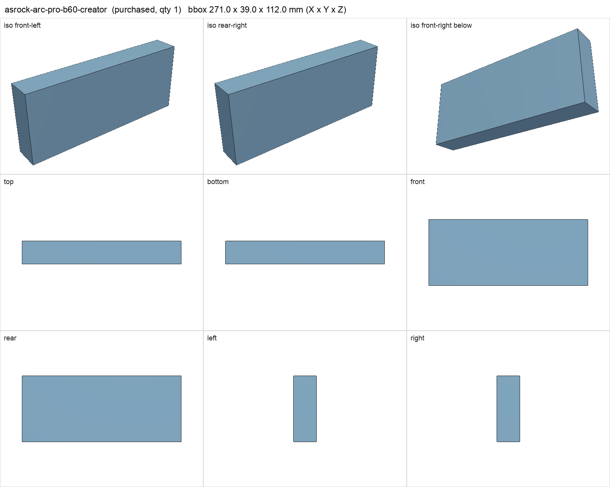
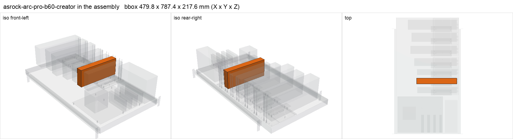

# ASRock Intel Arc Pro B60 Creator 24 GB (B60 CT 24G)

<!-- Generated by make check from part.toml. Edit part.toml, not this file. -->

| | |
| --- | --- |
| ID | `asrock-arc-pro-b60-creator` |
| Category | purchased |
| Role | GPU under test (blower cooler), 3 baseboard positions |
| Status | candidate |
| Quantity | 1 |
| Systems | node |
| Product | <https://www.pbtech.com/product/VGAASR0060/ASRock-Intel-Arc-Pro-B60-Creator-24GB-GDDR6-Graphi> |

Intel makes no reference B60; ASRock Creator chosen. Blower: air exits through the bracket. Board dimensions are from listings only.
Occupies 3 positions (thickness plus a few mm air gap at the 20.32 mm pitch).
Running on an MCIO riser at x8; values marked review/listing are provisional.

## Model

- [asrock-arc-pro-b60-creator.step](asrock-arc-pro-b60-creator.step)
- Source: constructed. Body envelope only: length x height x thickness.
- Assembly: 1 instances in the assembly

## Datasheets

- [Intel Arc Pro B60 specifications](https://www.intel.com/content/www/us/en/products/sku/243916/intel-arc-pro-b60-graphics/specifications.html)
- [Intel Arc Pro B60 datasheet](https://www.intel.com/content/dam/www/central-libraries/us/en/documents/2026-03/datasheet-b60-gpu.pdf)
- Local copies: `datasheets/` after `make datasheets` (not committed)

## Dimensions

| Key | Value | Evidence | Source / note |
| --- | --- | --- | --- |
| length | 271 mm | listing | retailer listing |
| height | 112 mm | listing | retailer listing |
| thickness | 39 mm | listing | retailer listing; 2-slot |
| tgp | 200 W | datasheet | Intel: 120-200 W |
| mass | 1.12 kg | listing | listings 1.1-1.118 kg |

## Interfaces

- requires `riser-x16-slot` value PCIe x16 count 1 (datasheet) — PCIe 5.0 x8 (x16 connector) card on an x8 riser link
- requires `gpu-baseboard-position` count 3 (allowance)
- requires `pcie-8pin` count 1 (datasheet) — 1 x 8-pin PCIe (listing)
- requires `dc-power` load 200 load_limited 160 (datasheet) — stock board power, including the 75 W slot power drawn through the riser; capped to 160 W for the 2800 W PSU budget: xpu-smi config -d <gpu> --powerlimit 160, set at boot and confirm the driver accepts it

## Compatibility checks

| Status | Rule | Interface | Detail |
| --- | --- | --- | --- |
| BLOCKED | budget | `shelf-load` | load 17.3 kg of 39.0 kg x derate 1.0 = 39.0 kg (44% of rating); unknown load for ['amd-radeon-ai-pro-r9700'] |
| provisional | budget | `dc-power` | load 2205.0 W of 2800.0 W x derate 0.8 = 2240.0 W (79% of rating); relies on configured limits of ['amd-radeon-ai-pro-r9700', 'amd-rx-7900-xtx-reference', 'asrock-arc-pro-b60-creator', 'intel-arc-pro-b70', 'nvidia-rtx-3090-fe', 'nvidia-rtx-4090-fe', 'zotac-rtx-5090-solid']; unlimited peak 2755.0 W |
| provisional | count | `gpu-baseboard-position` | need 26 x gpu-baseboard-position, have 26 |
| provisional | count | `pcie-8pin` | need 16 x pcie-8pin, have 16 |
| pass | value | `riser-x16-slot` | asrock-arc-pro-b60-creator needs PCIe x16; provided by cpayne-cp0231-mcio-device-adapter |
| pass | count | `riser-x16-slot` | need 7 x riser-x16-slot=pcie x16, have 7 |

