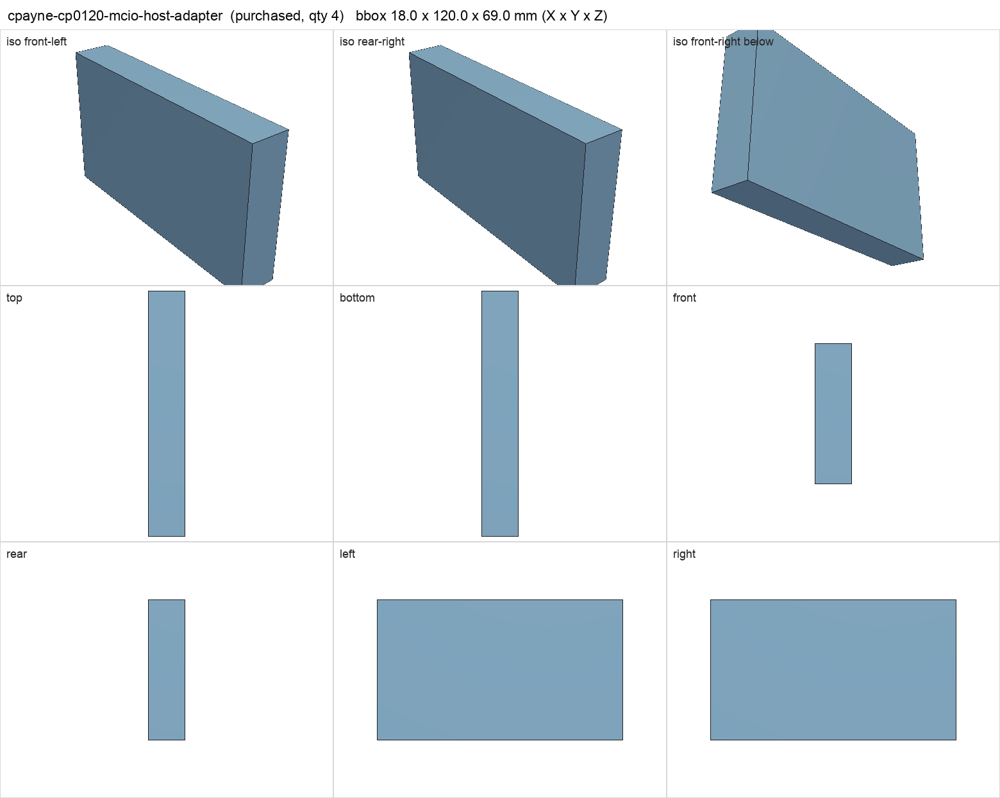
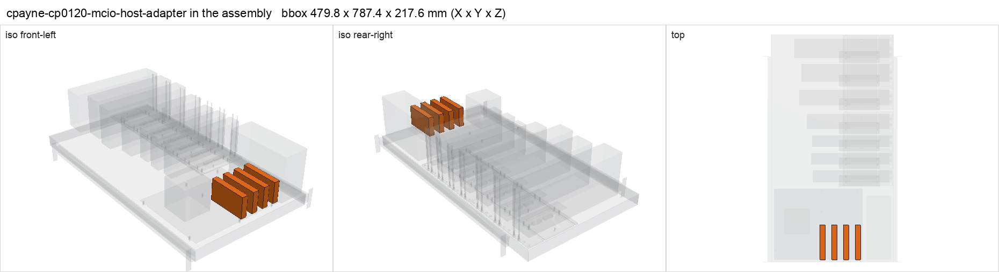

# C-Payne CP-0120 MCIO PCIe gen5 Host Adapter x16 (passive)

<!-- Generated by make check from part.toml. Edit part.toml, not this file. -->

| | |
| --- | --- |
| ID | `cpayne-cp0120-mcio-host-adapter` |
| Category | purchased |
| Role | host adapter: one H12D x16 slot to two MCIO 8i ports (x8x8) |
| Status | candidate |
| Quantity | 4 |
| Systems | node |
| Product | <https://c-payne.com/products/mcio-pcie-gen5-host-adapter-x16-passive> |

Passive; needs x8x8 bifurcation on the H12D slot. Whether each port gets its
own REFCLK/PERST is not documented: ask C-Payne before buying. The card
envelope is an allowance until the 3D model or a measurement is available.
Fallback for unstable links: CP-0131/0132 retimer version.

## Model

- [cpayne-cp0120-mcio-host-adapter.step](cpayne-cp0120-mcio-host-adapter.step)
- Source: constructed
- Assembly: 4 instances in the assembly

## Datasheets

- [C-Payne CP-0120 product page](https://c-payne.com/products/mcio-pcie-gen5-host-adapter-x16-passive)
- Local copies: `datasheets/` after `make datasheets` (not committed)

## Dimensions

| Key | Value | Evidence | Source / note |
| --- | --- | --- | --- |
| length | 120 mm | allowance | card length past the bracket; unmeasured |
| height | 69 mm | allowance | low-profile class; unmeasured |
| thickness | 18 mm | allowance | MCIO connectors plus cable latch |
| mass | 0.05 kg | assumed |  |

## Interfaces

- provides `mcio-8i-port` count 2 (datasheet)
- requires `pcie-x16-slot` value PCIe x16 count 1 (photo-estimate)
- requires `pcie-bifurcation-x8x8` count 1 (photo-estimate) — each slot split x8x8 in the BIOS

## Compatibility checks

| Status | Rule | Interface | Detail |
| --- | --- | --- | --- |
| BLOCKED | count | `pcie-bifurcation-x8x8` | need 4 x pcie-bifurcation-x8x8, have None |
| BLOCKED | budget | `shelf-load` | load 17.3 kg of 39.0 kg x derate 1.0 = 39.0 kg (44% of rating); unknown load for ['amd-radeon-ai-pro-r9700'] |
| provisional | value | `pcie-x16-slot` | cpayne-cp0120-mcio-host-adapter needs PCIe x16; provided by huananzhi-h12d-8d |
| provisional | count | `pcie-x16-slot` | need 4 x pcie-x16-slot=pcie x16, have 4 |
| pass | count | `mcio-8i-port` | need 7 x mcio-8i-port, have 8 |

