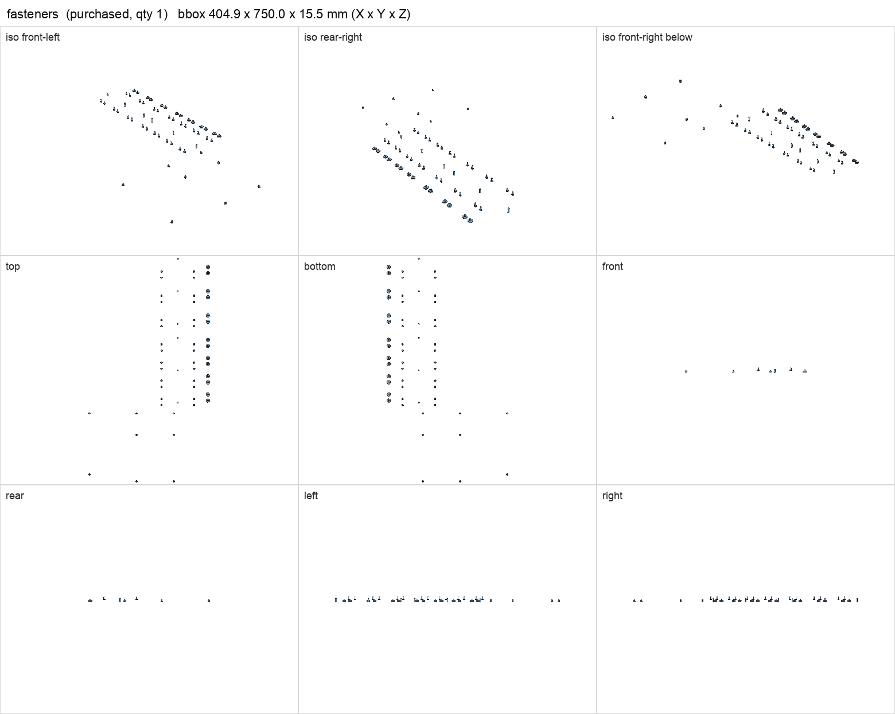
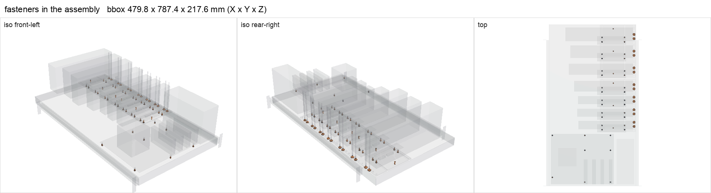

# Shelf and component fasteners (M3/M4/#6-32 screws, washers, nuts)

<!-- Generated by make check from part.toml. Edit part.toml, not this file. -->

| | |
| --- | --- |
| ID | `fasteners` |
| Category | purchased |
| Role | post, board, baseboard and riser fasteners |
| Status | candidate |
| Quantity | 1 |
| Systems | node, shelf |

## Model

- [fasteners.step](fasteners.step)
- Source: constructed. Shafts, heads and washers at nominal size.
- Assembly: 98 instances in the assembly

## Datasheets

- None recorded. Generic ISO metric and UNC hardware; choose lengths from the stacks in models/gpulab-fit-report.json.

## Dimensions

| Key | Value | Evidence | Source / note |
| --- | --- | --- | --- |
| mass | 0.3 kg | assumed |  |

## Compatibility checks

| Status | Rule | Interface | Detail |
| --- | --- | --- | --- |
| BLOCKED | budget | `shelf-load` | load 17.3 kg of 39.0 kg x derate 1.0 = 39.0 kg (44% of rating); unknown load for ['amd-radeon-ai-pro-r9700'] |

