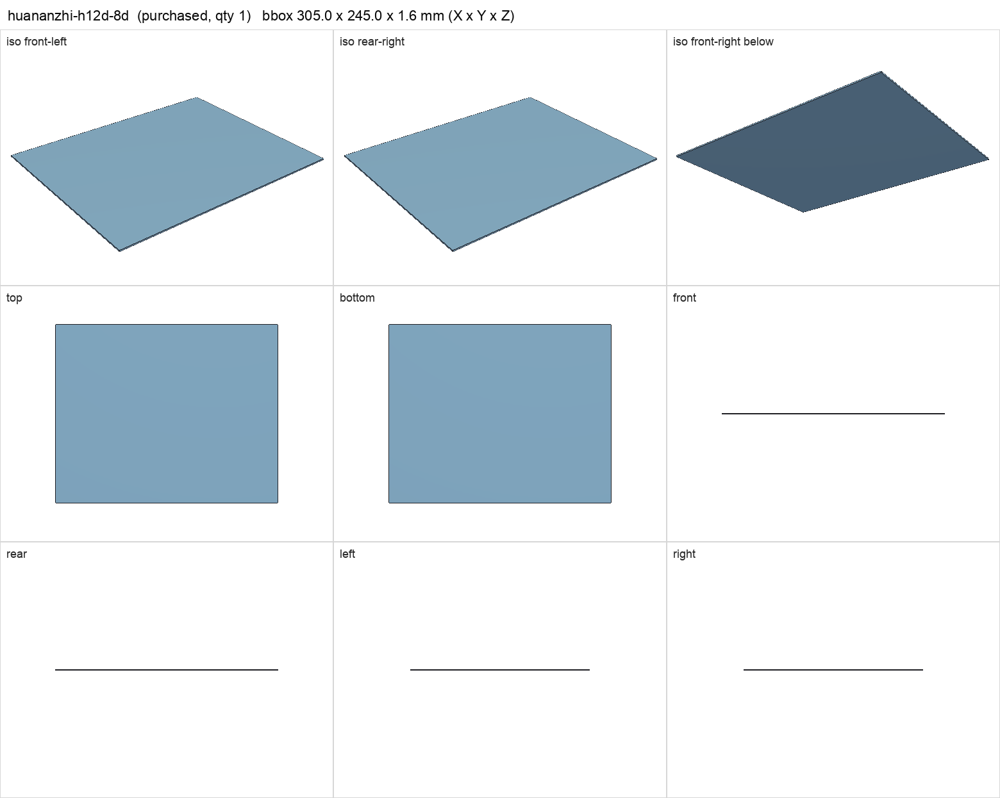
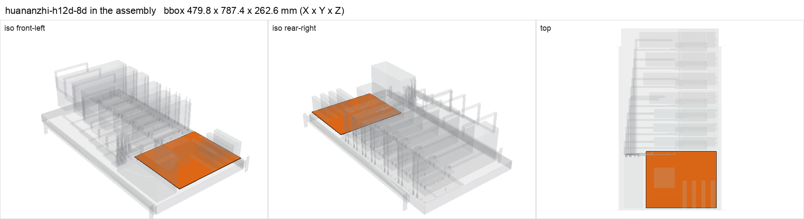

# HUANANZHI H12D-8D motherboard with BMC

<!-- Generated by make check from part.toml. Edit part.toml, not this file. -->

| | |
| --- | --- |
| ID | `huananzhi-h12d-8d` |
| Category | purchased |
| Role | GPU lab host board: four x16 slots, each split x8x8 for two cabled GPUs |
| Status | selected |
| Quantity | 1 |
| Systems | node |
| Product | <https://www.huananzhi.com/en/list_6/177.html> |
| Listing | <https://www.ebay.com/itm/396800856844> |

GPU lab copy of the AIPC (Berserk) spec; a second board is needed unless
Berserk's is moved here. x8x8 bifurcation is NOT documented in the manual or
any found source: check AMD CBS -> NBIO in the BIOS before buying adapters.
Placement of the CPU, DIMMs, M.2 standoffs, BMC and slot planes comes from the
manufacturer photograph (cad/berserk_platform.py), not manufacturer CAD.
Standoff sites A/C/F/G/H/K/L/M are populated; B and J are absent.
First boot 2026-11-07, read from the running system: PCB V2.0 (DMI), AMI
BIOS 2.2 dated 2026-01-06, ASPEED BMC firmware 1.01 (BMC MAC
00:e0:97:2a:aa:fc, DHCP), two Intel I226-V 2.5GbE ports. The I226-V has no
BMC sideband, so the BMC needs its own RJ45 cable. The bundled EPYC 7702P
boots, so it is not locked to another vendor's board. The BMC reports FAN1-8
headers and inlet/outlet temperatures.

## Model

- [huananzhi-h12d-8d.step](huananzhi-h12d-8d.step)
- Source: constructed. PCB plate plus BMC envelope; component positions photo-estimated.
- Assembly: 1 instances in the assembly

## Datasheets

- [HUANANZHI H12D-8D product page](https://www.huananzhi.com/en/list_6/177.html)
- [HUANANZHI H12D-8D user manual](https://www.huananzhi.com/uploads/file/20260212/1770877734213650.pdf)
- Local copies: `datasheets/` after `make datasheets` (not committed)

## Dimensions

| Key | Value | Evidence | Source / note |
| --- | --- | --- | --- |
| pcb_width | 305 mm | datasheet | product page: Dimension 305*245MM ATX |
| pcb_depth | 245 mm | datasheet | product page: Dimension 305*245MM ATX |
| pcb_thickness | 1.6 mm | assumed |  |
| slot1_plane_x | 142.5 mm | photo-estimate | AIPC berserk_platform: first slot plane from the PCB low-X edge, I/O edge toward +Y |
| slot_pitch | 40.64 mm | standard | PCIe CEM two-slot pitch; positions after slot 1 assumed on it |
| cpu_center_x | 225.9 mm | photo-estimate | AIPC berserk_platform photo_xy(833,397) |
| cpu_center_from_io_edge | 131.4 mm | photo-estimate | AIPC berserk_platform photo_xy(833,397) |
| atx24_x | 280 mm | allowance | 24-pin assumed on the edge opposite the I/O, toward the low-X side (ATX convention); read the manual layout figure |
| eps_x | 210 mm | allowance | two EPS 8-pin assumed on the edge opposite the I/O, near the CPU; read the manual layout figure |
| mass | 1.2 kg | assumed |  |

## Interfaces

- provides `cpu-socket` value SP3 (datasheet)
- provides `memory-slot` value DDR4 RDIMM count 8 (datasheet) — product page: 8 x DDR4 slots, octa-channel
- provides `pcie-x16-slot` value PCIe x16 count 4 (datasheet) — product page: 4 x PCIe 4.0 x16; slot plane positions photo-estimated
- provides `pcie-bifurcation-x8x8` count **unknown** (listing) — x8x8 per x16 slot: not in the manual; EPYC supports it, the BIOS menu is unconfirmed. Check AMD CBS -> NBIO
- provides `m2-slot` value M.2 2280 NVMe count 3 (datasheet) — three PCIe 4.0 x4 slots per manufacturer page
- provides `sff-8643-port` accepts ['PCIe 4.0 x4 U.2', '4 x SATA 6Gb/s'] count 3 (datasheet) — product page: 3 x SFF-8643 supports expand 12 x SATA3.0 6Gbps or 3 x PCIE4.0 x4 U.2; manual spec list: 3xMINISAS(SATA*4&PCIE3.0/4.0X4). Neither document says how a port is switched between SATA and PCIe (BIOS, jumper or auto-detect) or whether two ports can be grouped as x8; connector positions are photo-estimated from the manual layout figure only. Candidate host for a cabled PCIe riser and NIC, since all four x16 slots carry V100s
- provides `sata-port` value SATA 6Gb/s count 4 (datasheet) — product page: 4xSATA3.0 6Gbps; separate from the SFF-8643 SATA mode
- provides `usb2-header` count **unknown** (listing) — internal USB 2.0 header not listed on the product page; check the manual or board
- requires `board-standoff` value #6-32 F/F count 8 (photo-estimate) — populated sites A/C/F/G/H/K/L/M; screwed from below through the drilled steel deck
- requires `atx-24pin` count 1 (datasheet) — product page: 24PIN+8PIN+8PIN
- requires `eps-8pin-cpu` count 2 (datasheet) — product page: 24PIN+8PIN+8PIN
- requires `dc-power` load 60 (assumed) — board, BMC and chipset allowance

## Compatibility checks

| Status | Rule | Interface | Detail |
| --- | --- | --- | --- |
| BLOCKED | count | `pcie-bifurcation-x8x8` | need 4 x pcie-bifurcation-x8x8, have None |
| BLOCKED | budget | `shelf-load` | load 18.5 kg of 39.0 kg x derate 1.0 = 39.0 kg (47% of rating); unknown load for ['amd-radeon-ai-pro-r9700'] |
| provisional | count | `atx-24pin` | need 1 x atx-24pin, have 1 |
| provisional | value | `board-standoff` | huananzhi-h12d-8d needs #6-32 F/F; provided by keystone-1451b |
| provisional | count | `board-standoff` | need 8 x board-standoff=#6-32 f/f, have 8 |
| provisional | budget | `dc-power` | load 2205.0 W of 2800.0 W x derate 0.8 = 2240.0 W (79% of rating); relies on configured limits of ['amd-radeon-ai-pro-r9700', 'amd-rx-7900-xtx-reference', 'asrock-arc-pro-b60-creator', 'intel-arc-pro-b70', 'nvidia-rtx-3090-fe', 'nvidia-rtx-4090-fe', 'zotac-rtx-5090-solid']; unlimited peak 2755.0 W |
| provisional | count | `eps-8pin-cpu` | need 2 x eps-8pin-cpu, have 2 |
| provisional | value | `pcie-x16-slot` | cpayne-cp0120-mcio-host-adapter needs PCIe x16; provided by huananzhi-h12d-8d |
| provisional | count | `pcie-x16-slot` | need 4 x pcie-x16-slot=pcie x16, have 4 |
| pass | value | `cpu-socket` | amd-epyc-7702p needs SP3; provided by huananzhi-h12d-8d |

