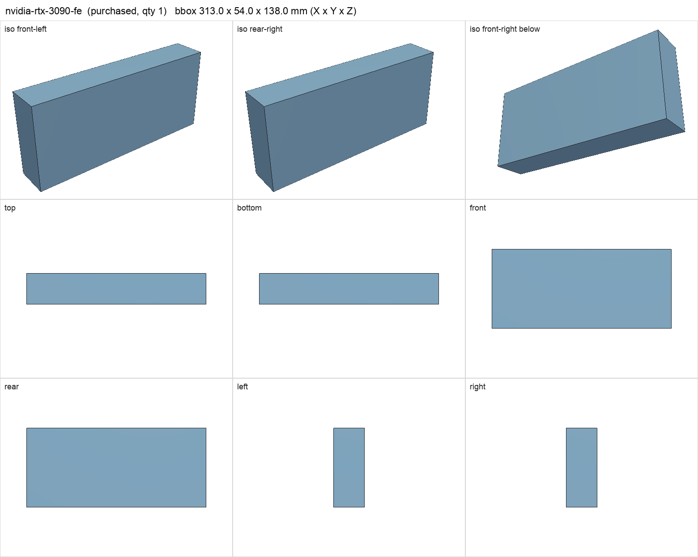
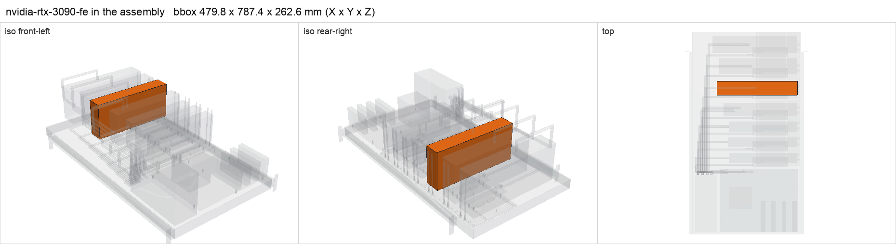

# NVIDIA GeForce RTX 3090 Founders Edition

<!-- Generated by make check from part.toml. Edit part.toml, not this file. -->

| | |
| --- | --- |
| ID | `nvidia-rtx-3090-fe` |
| Category | purchased |
| Role | GPU under test (flow-through cooler), 4 baseboard positions |
| Status | candidate |
| Quantity | 1 |
| Systems | node |
| Product | <https://www.nvidia.com/en-us/geforce/graphics-cards/30-series/rtx-3090-3090ti/> |

3-slot flow-through cooler: the I/O-end fan exhausts through the bracket, the tail fan blows through the fin stack.
Occupies 4 positions (thickness plus 15-25 mm air gap at the 20.32 mm pitch).
Running on an MCIO riser at x8; values marked review/listing are provisional.

## Model

- [nvidia-rtx-3090-fe.step](nvidia-rtx-3090-fe.step)
- Source: constructed. Body envelope only: length x height x thickness.
- Assembly: 1 instances in the assembly

## Datasheets

- [NVIDIA RTX 3090 specifications](https://www.nvidia.com/en-us/geforce/graphics-cards/30-series/rtx-3090-3090ti/)
- Local copies: `datasheets/` after `make datasheets` (not committed)

## Dimensions

| Key | Value | Evidence | Source / note |
| --- | --- | --- | --- |
| length | 313 mm | datasheet | NVIDIA spec page |
| height | 138 mm | datasheet | NVIDIA spec page |
| thickness | 54 mm | review | Tom's Hardware measurement; NVIDIA lists 3-slot only |
| tgp | 350 W | datasheet | NVIDIA spec page |
| mass | 2.2 kg | review | reviews 2.19-2.21 kg |
| power_connector_from_tail | 150 mm | allowance | 12-pin on the top edge near mid-length (angled), from product photos; 0 means on the tail end. Not measured |

## Interfaces

- requires `riser-x16-slot` value PCIe x16 count 1 (datasheet) — PCIe 4.0 x16 card on an x8 riser link
- requires `gpu-baseboard-position` count 4 (allowance)
- requires `12v-2x6` count 1 (datasheet) — NVIDIA 12-pin socket; a 12V-2x6/12VHPWR cable fits it (sense pins unused), or NVIDIA's 2 x 8-pin adapter
- requires `dc-power` load 350 load_limited 250 (datasheet) — stock board power, including the 75 W slot power drawn through the riser; capped to 250 W for the 2800 W PSU budget: nvidia-smi -i <gpu> -pl 250, set at boot and confirm the driver accepts it

## Compatibility checks

| Status | Rule | Interface | Detail |
| --- | --- | --- | --- |
| BLOCKED | budget | `shelf-load` | load 18.5 kg of 39.0 kg x derate 1.0 = 39.0 kg (47% of rating); unknown load for ['amd-radeon-ai-pro-r9700'] |
| provisional | count | `12v-2x6` | need 4 x 12v-2x6, have 4 |
| provisional | budget | `dc-power` | load 2205.0 W of 2800.0 W x derate 0.8 = 2240.0 W (79% of rating); relies on configured limits of ['amd-radeon-ai-pro-r9700', 'amd-rx-7900-xtx-reference', 'asrock-arc-pro-b60-creator', 'intel-arc-pro-b70', 'nvidia-rtx-3090-fe', 'nvidia-rtx-4090-fe', 'zotac-rtx-5090-solid']; unlimited peak 2755.0 W |
| provisional | count | `gpu-baseboard-position` | need 26 x gpu-baseboard-position, have 26 |
| pass | value | `riser-x16-slot` | nvidia-rtx-3090-fe needs PCIe x16; provided by cpayne-cp0231-mcio-device-adapter |
| pass | count | `riser-x16-slot` | need 7 x riser-x16-slot=pcie x16, have 7 |

