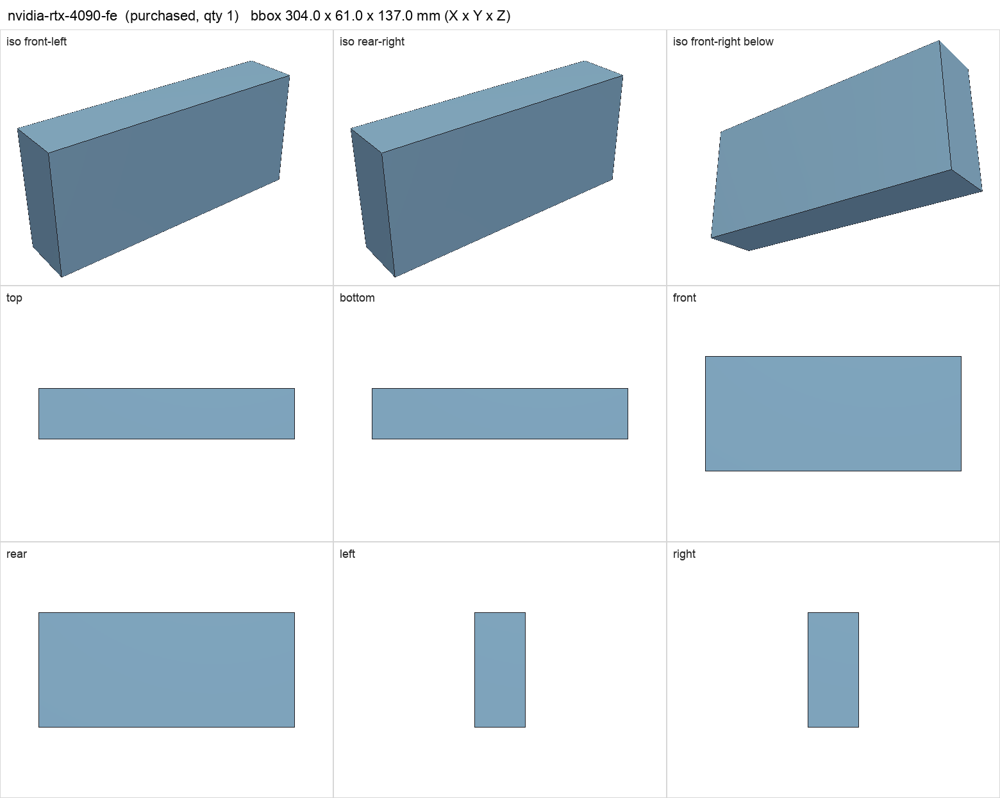
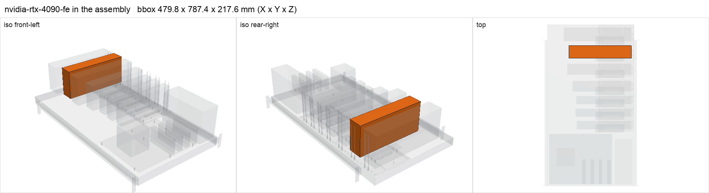

# NVIDIA GeForce RTX 4090 Founders Edition

<!-- Generated by make check from part.toml. Edit part.toml, not this file. -->

| | |
| --- | --- |
| ID | `nvidia-rtx-4090-fe` |
| Category | purchased |
| Role | GPU under test (flow-through cooler), 4 baseboard positions |
| Status | candidate |
| Quantity | 1 |
| Systems | node |
| Product | <https://www.nvidia.com/en-us/geforce/graphics-cards/40-series/rtx-4090/> |

Same flow-through layout as the 3090 FE.
Occupies 4 positions (thickness plus 15-25 mm air gap at the 20.32 mm pitch).
Running on an MCIO riser at x8; values marked review/listing are provisional.

## Model

- [nvidia-rtx-4090-fe.step](nvidia-rtx-4090-fe.step)
- Source: constructed. Body envelope only: length x height x thickness.
- Assembly: 1 instances in the assembly

## Datasheets

- [NVIDIA RTX 4090 specifications](https://www.nvidia.com/en-us/geforce/graphics-cards/40-series/rtx-4090/)
- Local copies: `datasheets/` after `make datasheets` (not committed)

## Dimensions

| Key | Value | Evidence | Source / note |
| --- | --- | --- | --- |
| length | 304 mm | datasheet | NVIDIA spec page |
| height | 137 mm | datasheet | NVIDIA spec page; KitGuru measured 147 mm |
| thickness | 61 mm | datasheet | NVIDIA spec page |
| tgp | 450 W | datasheet | NVIDIA spec page |
| mass | 2.19 kg | review | reviews 2.186 kg; Puget lists 2.254 kg |

## Interfaces

- requires `riser-x16-slot` value PCIe x16 count 1 (datasheet) — PCIe 4.0 x16 card on an x8 riser link
- requires `gpu-baseboard-position` count 4 (allowance)
- requires `12v-2x6` count 1 (datasheet) — 16-pin 12VHPWR; a 12V-2x6 cable fits
- requires `dc-power` load 450 load_limited 320 (datasheet) — stock board power, including the 75 W slot power drawn through the riser; capped to 320 W for the 2800 W PSU budget: nvidia-smi -i <gpu> -pl 320, set at boot and confirm the driver accepts it

## Compatibility checks

| Status | Rule | Interface | Detail |
| --- | --- | --- | --- |
| BLOCKED | budget | `shelf-load` | load 17.3 kg of 39.0 kg x derate 1.0 = 39.0 kg (44% of rating); unknown load for ['amd-radeon-ai-pro-r9700'] |
| provisional | count | `12v-2x6` | need 4 x 12v-2x6, have 4 |
| provisional | budget | `dc-power` | load 2205.0 W of 2800.0 W x derate 0.8 = 2240.0 W (79% of rating); relies on configured limits of ['amd-radeon-ai-pro-r9700', 'amd-rx-7900-xtx-reference', 'asrock-arc-pro-b60-creator', 'intel-arc-pro-b70', 'nvidia-rtx-3090-fe', 'nvidia-rtx-4090-fe', 'zotac-rtx-5090-solid']; unlimited peak 2755.0 W |
| provisional | count | `gpu-baseboard-position` | need 26 x gpu-baseboard-position, have 26 |
| pass | value | `riser-x16-slot` | nvidia-rtx-4090-fe needs PCIe x16; provided by cpayne-cp0231-mcio-device-adapter |
| pass | count | `riser-x16-slot` | need 7 x riser-x16-slot=pcie x16, have 7 |

