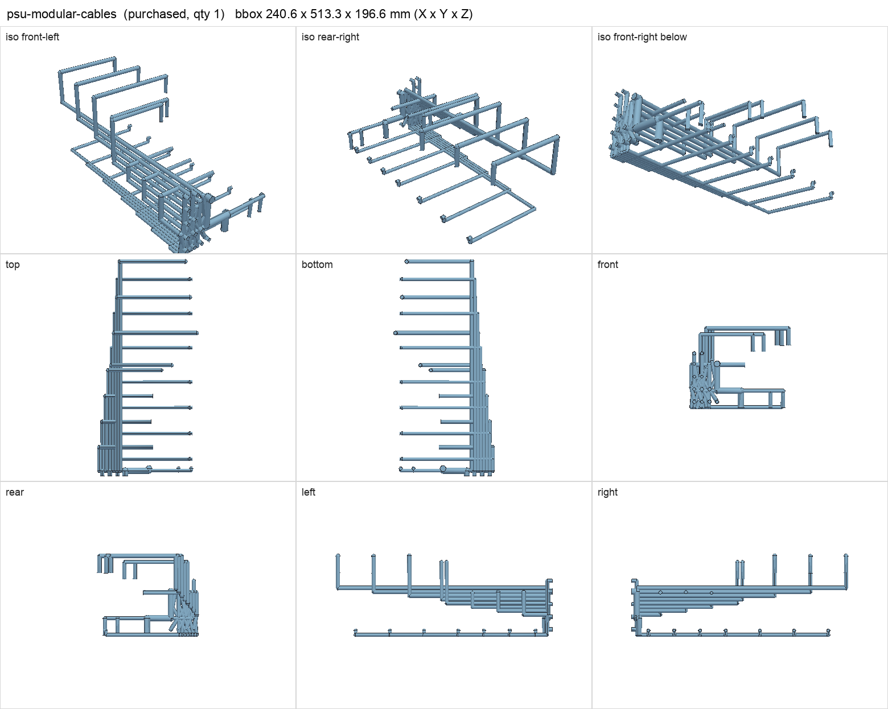
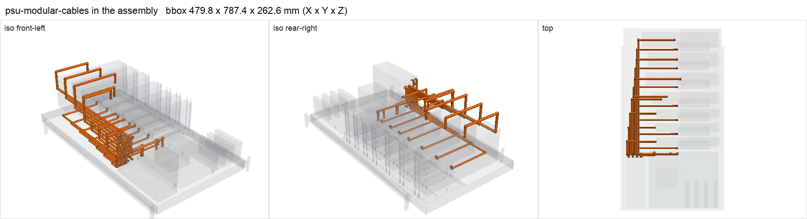

# Super Flower Leadex 2800W modular cable set (approximate routes)

<!-- Generated by make check from part.toml. Edit part.toml, not this file. -->

| | |
| --- | --- |
| ID | `psu-modular-cables` |
| Category | purchased |
| Role | power leads from the PSU to the GPUs, riser boards and board |
| Status | candidate |
| Quantity | 1 |
| Systems | node |

Modeled as round bundles along simple orthogonal routes: from the PSU's modular
face, back along the left edge of the deck past the card tails, then to each
connector. Riser leads run low (under the card bodies) through the gaps between
cards; leads to top-edge GPU connectors rise 40 mm above the card for the bend.
Bundle diameters are allowances. The splitters are modeled as separate riser
leads. Cables may touch each other; they are checked only against rigid parts.

## Model

- [psu-modular-cables.step](psu-modular-cables.step)
- Source: constructed
- Assembly: 18 instances in the assembly

## Datasheets

- None recorded. Ships with the PSU; lead lengths are not published. Measure them against models/gpulab-fit-report.json.

## Dimensions

| Key | Value | Evidence | Source / note |
| --- | --- | --- | --- |
| mass | 1.2 kg | assumed |  |

## Compatibility checks

| Status | Rule | Interface | Detail |
| --- | --- | --- | --- |
| BLOCKED | budget | `shelf-load` | load 18.5 kg of 39.0 kg x derate 1.0 = 39.0 kg (47% of rating); unknown load for ['amd-radeon-ai-pro-r9700'] |

