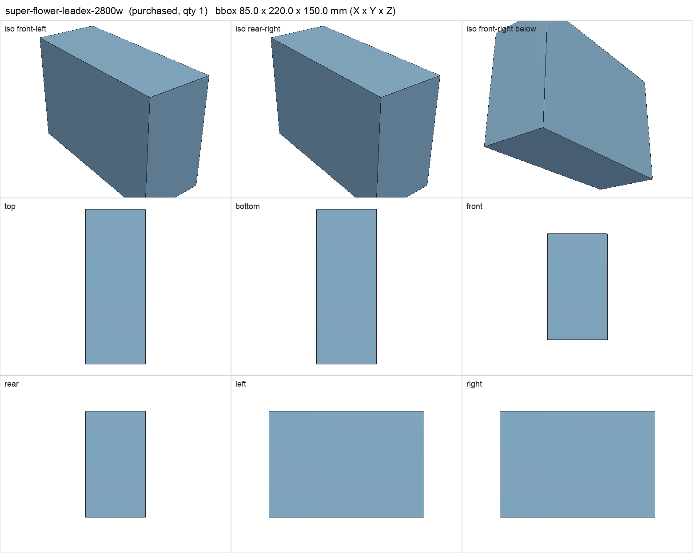
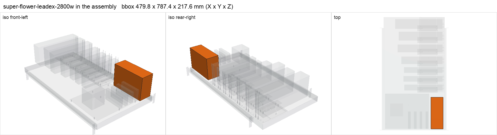

# Super Flower Leadex 2800W ATX 3.1 (SF-2800F14HP)

<!-- Generated by make check from part.toml. Edit part.toml, not this file. -->

| | |
| --- | --- |
| ID | `super-flower-leadex-2800w` |
| Category | purchased |
| Role | node PSU: board, CPU, GPUs and riser boards |
| Status | selected |
| Quantity | 1 |
| Systems | node |
| Product | <https://www.super-flower.com.tw/> |
| Review | <https://hwbusters.com/psus/super-flower-leadex-2800w-atx-v3-1-psu-review/> |

200-240 V input only; no 115 V rating is published. Super Flower's own spec
page was not reachable, so the values come from the HWBusters review; sources
disagree on depth (200 mm review and PCPartPicker, 220 mm Puget): the model uses
220 mm. Lies on its side beside the board, fan facing the deck centre.

## Model

- [super-flower-leadex-2800w.step](super-flower-leadex-2800w.step)
- Source: constructed
- Assembly: 1 instances in the assembly

## Datasheets

- [HWBusters review (no manufacturer spec sheet found)](https://hwbusters.com/psus/super-flower-leadex-2800w-atx-v3-1-psu-review/)
- Local copies: `datasheets/` after `make datasheets` (not committed)

## Dimensions

| Key | Value | Evidence | Source / note |
| --- | --- | --- | --- |
| width | 150 mm | review | HWBusters |
| height | 85 mm | review | HWBusters; Puget lists 86 |
| depth | 220 mm | listing | Puget 220 mm; HWBusters and PCPartPicker 200 mm; larger value used |
| mass | 2.99 kg | review | HWBusters |

## Interfaces

- provides `dc-power` capacity 2800 W (review) — +12 V 233.3 A
- provides `atx-24pin` count 1 (review)
- provides `eps-8pin-cpu` count 2 (review)
- provides `12v-2x6` count 4 (review)
- provides `pcie-8pin` count 6 (review) — 6+2 pin connectors
- provides `sata-power` count 16 (review)
- provides `peripheral-12v` count 4 (review)
- requires `ac-power` load 3060 W (allowance) — 2.8 kW output / ~0.915 efficiency at full load

## Compatibility checks

| Status | Rule | Interface | Detail |
| --- | --- | --- | --- |
| BLOCKED | budget | `ac-power` | load 3060.0 W; capacity unknown |
| BLOCKED | budget | `shelf-load` | load 17.3 kg of 39.0 kg x derate 1.0 = 39.0 kg (44% of rating); unknown load for ['amd-radeon-ai-pro-r9700'] |
| provisional | count | `12v-2x6` | need 4 x 12v-2x6, have 4 |
| provisional | count | `atx-24pin` | need 1 x atx-24pin, have 1 |
| provisional | budget | `dc-power` | load 2205.0 W of 2800.0 W x derate 0.8 = 2240.0 W (79% of rating); relies on configured limits of ['amd-radeon-ai-pro-r9700', 'amd-rx-7900-xtx-reference', 'asrock-arc-pro-b60-creator', 'intel-arc-pro-b70', 'nvidia-rtx-3090-fe', 'nvidia-rtx-4090-fe', 'zotac-rtx-5090-solid']; unlimited peak 2755.0 W |
| provisional | count | `eps-8pin-cpu` | need 2 x eps-8pin-cpu, have 2 |
| provisional | count | `pcie-8pin` | need 16 x pcie-8pin, have 16 |

