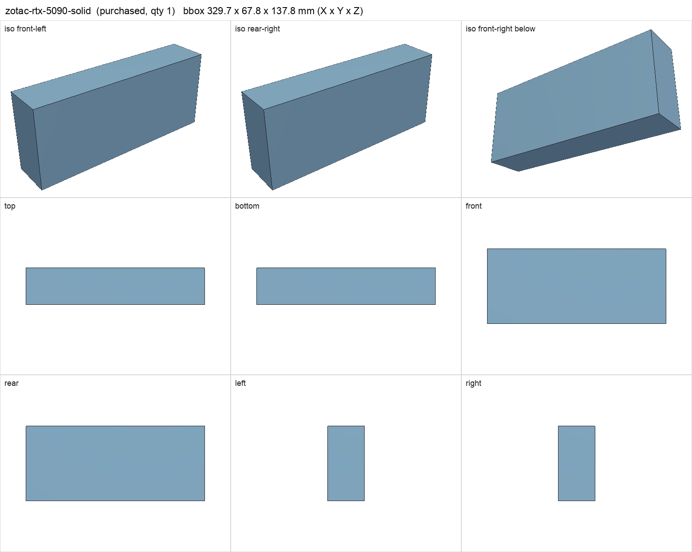
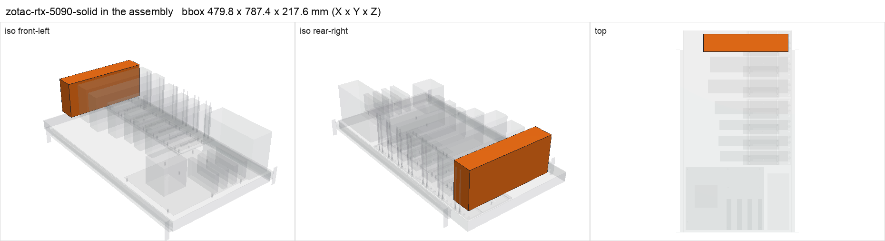

# Zotac Gaming GeForce RTX 5090 Solid 32 GB

<!-- Generated by make check from part.toml. Edit part.toml, not this file. -->

| | |
| --- | --- |
| ID | `zotac-rtx-5090-solid` |
| Category | purchased |
| Role | GPU under test (open-air cooler), 5 baseboard positions |
| Status | candidate |
| Quantity | 1 |
| Systems | node |
| Product | <https://www.zotac.com/us/product/graphics_card/zotac-gaming-geforce-rtx-5090-solid> |

Open-air, three axial fans: heat goes into the surrounding air. Reviews call it 3.5- or 4-slot; plan on 67.8 mm.
Occupies 5 positions (thickness plus 15-25 mm air gap at the 20.32 mm pitch).
Running on an MCIO riser at x8; values marked review/listing are provisional.

## Model

- [zotac-rtx-5090-solid.step](zotac-rtx-5090-solid.step)
- Source: constructed. Body envelope only: length x height x thickness.
- Assembly: 1 instances in the assembly

## Datasheets

- [Zotac RTX 5090 Solid specifications](https://www.zotac.com/us/product/graphics_card/zotac-gaming-geforce-rtx-5090-solid)
- Local copies: `datasheets/` after `make datasheets` (not committed)

## Dimensions

| Key | Value | Evidence | Source / note |
| --- | --- | --- | --- |
| length | 329.7 mm | datasheet | Zotac published dimensions |
| height | 137.8 mm | datasheet | Zotac published dimensions |
| thickness | 67.8 mm | datasheet | Zotac published dimensions |
| tgp | 575 W | datasheet | NVIDIA RTX 5090 total graphics power |
| mass | 2.29 kg | review | Notebookcheck 2.287 kg |

## Interfaces

- requires `riser-x16-slot` value PCIe x16 count 1 (datasheet) — PCIe 5.0 x16 card on an x8 riser link
- requires `gpu-baseboard-position` count 5 (allowance)
- requires `12v-2x6` count 1 (datasheet) — 16-pin 12V-2x6
- requires `dc-power` load 575 load_limited 400 (datasheet) — stock board power, including the 75 W slot power drawn through the riser; capped to 400 W for the 2800 W PSU budget: nvidia-smi -i <gpu> -pl 400, set at boot and confirm the driver accepts it

## Compatibility checks

| Status | Rule | Interface | Detail |
| --- | --- | --- | --- |
| BLOCKED | budget | `shelf-load` | load 17.3 kg of 39.0 kg x derate 1.0 = 39.0 kg (44% of rating); unknown load for ['amd-radeon-ai-pro-r9700'] |
| provisional | count | `12v-2x6` | need 4 x 12v-2x6, have 4 |
| provisional | budget | `dc-power` | load 2205.0 W of 2800.0 W x derate 0.8 = 2240.0 W (79% of rating); relies on configured limits of ['amd-radeon-ai-pro-r9700', 'amd-rx-7900-xtx-reference', 'asrock-arc-pro-b60-creator', 'intel-arc-pro-b70', 'nvidia-rtx-3090-fe', 'nvidia-rtx-4090-fe', 'zotac-rtx-5090-solid']; unlimited peak 2755.0 W |
| provisional | count | `gpu-baseboard-position` | need 26 x gpu-baseboard-position, have 26 |
| pass | value | `riser-x16-slot` | zotac-rtx-5090-solid needs PCIe x16; provided by cpayne-cp0231-mcio-device-adapter |
| pass | count | `riser-x16-slot` | need 7 x riser-x16-slot=pcie x16, have 7 |

