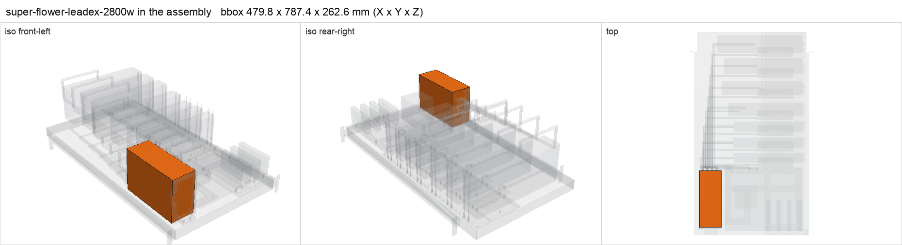

# Super Flower Leadex 2800W ATX 3.1 (SF-2800F14HP)

<!-- Generated by make check from super-flower-leadex-2800w.toml and the library part.toml. Edit those, not this file. -->

Library spec: [parts/purchased/super-flower-leadex-2800w](../../parts/purchased/super-flower-leadex-2800w/README.md) (dimensions, interfaces, datasheets, model).

| | |
| --- | --- |
| Role | node PSU: board, CPU, GPUs and riser boards |
| Status | selected |
| Quantity | 1 |
| Systems | node |

## Changes for this build

- requires `psu-restraint`: sets value ATX 150 x 86 face, count 1, evidence review — 150 x 85 mm face (HWBusters; Puget lists 86); the rear-face screw pattern is assumed ATX

## Assembly

- 1 instances in the assembly

## Compatibility checks

| Status | Rule | Interface | Detail |
| --- | --- | --- | --- |
| BLOCKED | budget | `ac-power` | load 3060.0 W; capacity unknown |
| BLOCKED | budget | `shelf-load` | load 18.7 kg of 39.0 kg x derate 1.0 = 39.0 kg (48% of rating); unknown load for ['amd-radeon-ai-pro-r9700'] |
| provisional | count | `12v-2x6` | need 4 x 12v-2x6, have 4 |
| provisional | count | `atx-24pin` | need 1 x atx-24pin, have 1 |
| provisional | budget | `dc-power` | load 2205.0 W of 2800.0 W x derate 0.8 = 2240.0 W (79% of rating); relies on configured limits of ['amd-radeon-ai-pro-r9700', 'amd-rx-7900-xtx-reference', 'asrock-arc-pro-b60-creator', 'intel-arc-pro-b70', 'nvidia-rtx-3090-fe', 'nvidia-rtx-4090-fe', 'zotac-rtx-5090-solid']; unlimited peak 2755.0 W |
| provisional | count | `eps-8pin-cpu` | need 2 x eps-8pin-cpu, have 2 |
| provisional | count | `pcie-8pin` | need 16 x pcie-8pin, have 16 |
| provisional | value | `psu-restraint` | super-flower-leadex-2800w needs ATX 150 x 86 face; provided by psu_bracket |
| provisional | count | `psu-restraint` | need 1 x psu-restraint=atx 150 x 86 face, have 1 |

