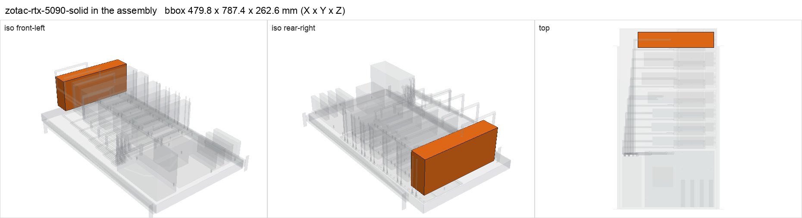

# Zotac Gaming GeForce RTX 5090 Solid 32 GB

<!-- Generated by make check from zotac-rtx-5090-solid.toml and the library part.toml. Edit those, not this file. -->

Library spec: [parts/purchased/zotac-rtx-5090-solid](../../parts/purchased/zotac-rtx-5090-solid/README.md) (dimensions, interfaces, datasheets, model).

| | |
| --- | --- |
| Role | GPU under test (open-air cooler), 5 baseboard positions |
| Status | candidate |
| Quantity | 1 |
| Systems | node |

Occupies 5 positions (thickness plus 15-25 mm air gap at the 20.32 mm pitch).
Runs on an MCIO riser at x8; values marked review/listing are provisional.

## Changes for this build

- requires `riser-x16-slot`: replaces `pcie-x16-slot` — PCIe 5.0 x16 card on an x8 riser link
- requires `gpu-baseboard-position`: sets count 5, evidence allowance
- requires `dc-power`: sets load_limited 400 — stock board power, including the 75 W slot power drawn through the riser; capped to 400 W for the 2800 W PSU budget: nvidia-smi -i <gpu> -pl 400, set at boot and confirm the driver accepts it

## Assembly

- 1 instances in the assembly

## Compatibility checks

| Status | Rule | Interface | Detail |
| --- | --- | --- | --- |
| BLOCKED | budget | `shelf-load` | load 18.5 kg of 39.0 kg x derate 1.0 = 39.0 kg (47% of rating); unknown load for ['amd-radeon-ai-pro-r9700'] |
| provisional | count | `12v-2x6` | need 4 x 12v-2x6, have 4 |
| provisional | budget | `dc-power` | load 2205.0 W of 2800.0 W x derate 0.8 = 2240.0 W (79% of rating); relies on configured limits of ['amd-radeon-ai-pro-r9700', 'amd-rx-7900-xtx-reference', 'asrock-arc-pro-b60-creator', 'intel-arc-pro-b70', 'nvidia-rtx-3090-fe', 'nvidia-rtx-4090-fe', 'zotac-rtx-5090-solid']; unlimited peak 2755.0 W |
| provisional | count | `gpu-baseboard-position` | need 26 x gpu-baseboard-position, have 26 |
| pass | value | `riser-x16-slot` | zotac-rtx-5090-solid needs PCIe x16; provided by cpayne-cp0231-mcio-device-adapter |
| pass | count | `riser-x16-slot` | need 7 x riser-x16-slot=pcie x16, have 7 |

