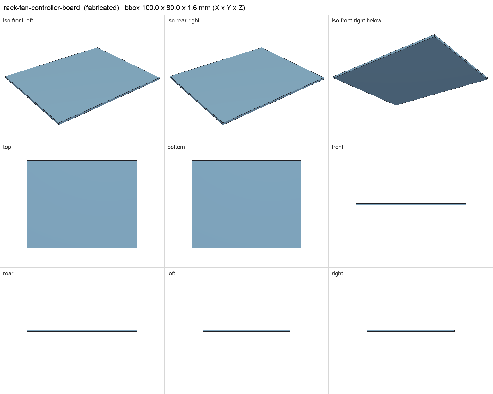

# Rack fan controller board (ESP32, 8 fan headers, 1-Wire)

<!-- Generated by make check from part.toml. Edit part.toml, not this file. -->

| | |
| --- | --- |
| ID | `rack-fan-controller-board` |
| Category | fabricated |

Hand-wired perfboard carrying the ESP32-DevKitC on female headers. Wiring and parts
list in rack/docs/wiring.md; firmware in rack/firmware/rack-fans.yaml.

12 V in on a 5.5 x 2.1 mm jack -> 2 A fuse -> 12 V bus to pin 2 of all eight fan
headers and the Recom R-78E5.0-1.0 (5 V out -> DevKitC 5V pin).
PWM: two channels, intake (headers 1-4, GPIO18) and exhaust (headers 5-8, GPIO19).
Each GPIO -> 1 kOhm -> 2N3904 base (10 kOhm base to emitter), emitter to ground,
collector to pin 4 of its four headers. The transistor sinks the fans' own PWM
pull-ups (open collector, as the 4-wire fan spec expects), so the output is inverted
in firmware. If the ESP32 is unpowered, resetting or crashed, the base is pulled low,
the transistor is off and the fans see an open PWM line: full speed.
Tach: pin 3 of each header -> 10 kOhm pull-up to 3.3 V and 1 kOhm series to its GPIO
(34, 35, 32, 33 intake; 25, 26, 27, 13 exhaust). GPIO36/39 are avoided because of
the ESP32 erratum on spurious low pulses there.
1-Wire: 3-way terminal 3V3 / DQ (GPIO4, 4.7 kOhm pull-up to 3V3) / GND for both probes.

## Used in

| Build | Qty | Status | Role |
| --- | ---: | --- | --- |
| [rack](../../../rack/parts/rack-fan-controller-board.md) | 1 | design | perfboard: 12 V distribution, 5 V converter, PWM drivers, tach pull-ups, 1-Wire terminal |

## Model

- [rack-fan-controller-board.step](rack-fan-controller-board.step)
- Source: constructed. Board envelope only; layout not drawn.
- Written by the `rack` build's generator

## Datasheets

- [Recom R-78E 1.0 A series datasheet](https://www.farnell.com/datasheets/2787646.pdf)
- [onsemi 2N3903/2N3904 datasheet](https://www.onsemi.com/pdf/datasheet/2n3903-d.pdf)
- Local copies: `datasheets/` after `make datasheets` (not committed)

## Dimensions

| Key | Value | Evidence | Source / note |
| --- | --- | --- | --- |
| board_width | 100 mm | allowance | perfboard size before layout |
| board_depth | 80 mm | allowance | perfboard size before layout |
| height | 25 mm | allowance | DevKitC on female headers |
| fuse_rating | 2 A | allowance | 8 x 0.08 A fans + 0.25 A converter input, with start-up margin; protects the perfboard bus, not the fans |
| converter_current | 1 A | datasheet | Recom R-78E5.0-1.0: 5 V, 1.0 A, 8-28 V in |
| converter_efficiency | 0.91 None | datasheet | Recom R-78E5.0-1.0: 91% at nominal input, full load |
| mass | 0.08 kg | assumed |  |

## Interfaces

- provides `fan-header-4pin` value 12 V 4-pin PWM count 8 (allowance) — headers 1-4 intake channel, 5-8 exhaust channel
- provides `devkitc-socket` count 1 (allowance)
- provides `dc-5v` capacity 5 W (datasheet) — Recom R-78E5.0-1.0, 5 V x 1.0 A
- provides `onewire-port` value 3.3 V, DQ, GND count 2 (allowance) — one terminal, both probes in parallel on one bus
- requires `dc-barrel-5.5x2.1` value 12 V, 5.5 x 2.1 mm, centre positive count 1 (allowance)
- requires `dc-12v` load 2.75 W (allowance) — the converter's input at the DevKitC's 2.5 W rating and 91% efficiency

