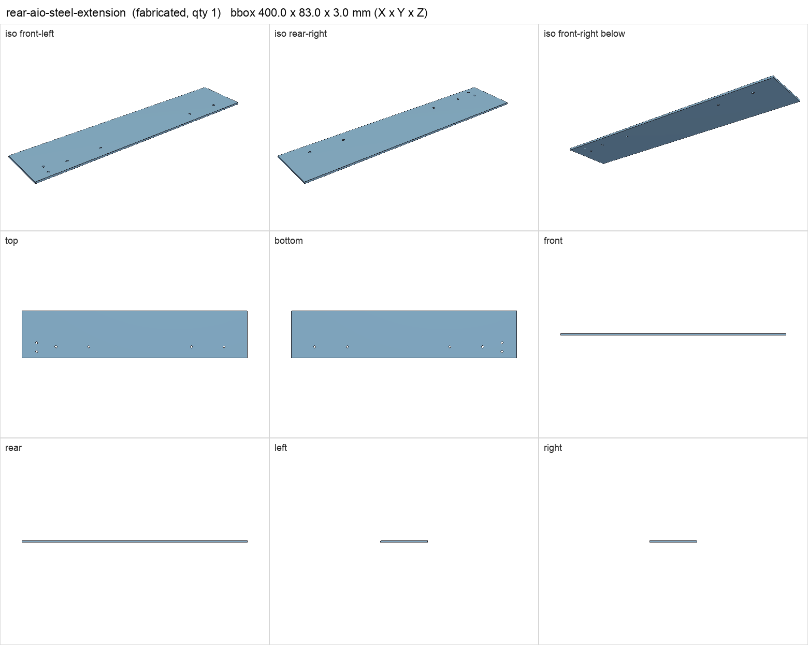
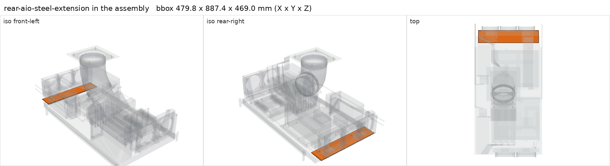

# Rear AIO steel extension plate, 400 x 83 x 3 mm

<!-- Generated by make check from part.toml. Edit part.toml, not this file. -->

| | |
| --- | --- |
| ID | `rear-aio-steel-extension` |
| Category | fabricated |
| Role | carries the rear radiator feet beyond the deck |
| Status | design |
| Quantity | 1 |
| Systems | kenshin, shelf |

Mild steel, six 5 mm holes shared with the frame and brace anchors. Deburr and coat. Loaded deflection untested.

## Model

- [rear-aio-steel-extension.step](rear-aio-steel-extension.step)
- Source: constructed. Drill plan also exported as models/rear-aio-steel-extension-drill-plan.step.
- Assembly: 1 instances in the assembly

## Datasheets

- None recorded. 

## Dimensions

| Key | Value | Evidence | Source / note |
| --- | --- | --- | --- |
| length | 400 mm | allowance |  |
| width | 83 mm | allowance |  |
| thickness | 3 mm | allowance |  |
| mass | 0.78 kg | allowance | steel 7.85 g/cm3 |

## Compatibility checks

| Status | Rule | Interface | Detail |
| --- | --- | --- | --- |
| BLOCKED | budget | `shelf-load` | load 23.2 kg of 39.0 kg x derate 1.0 = 39.0 kg (59% of rating); unknown load for ['fan-controller'] |

