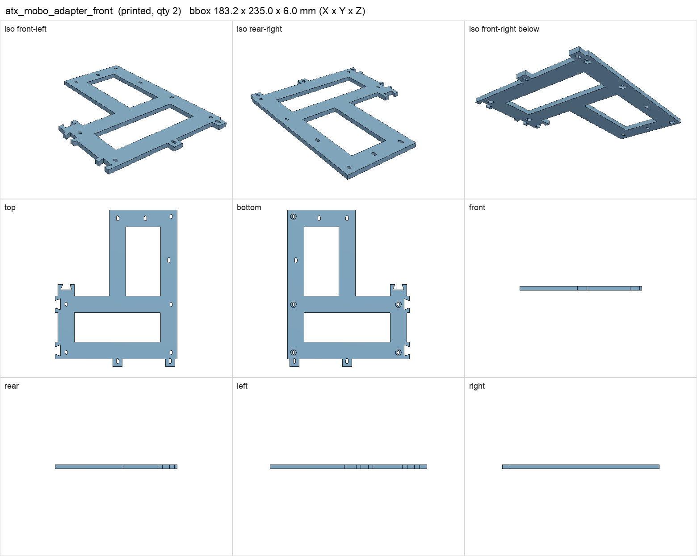
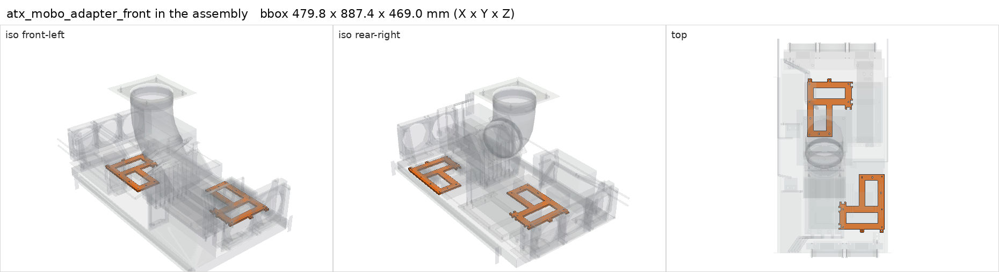

# atx_mobo_adapter_front

<!-- Generated by make check from part.toml. Edit part.toml, not this file. -->

| | |
| --- | --- |
| ID | `atx_mobo_adapter_front` |
| Category | printed |
| Role | shelf-front motherboard section, common to both boards |
| Status | design |
| Quantity | 2 |
| Systems | berserk, kenshin |
| Print | plate `01_atx_mobo_adapter_front`, PETG |

## Model

- [atx_mobo_adapter_front.step](atx_mobo_adapter_front.step) and [atx_mobo_adapter_front.stl](atx_mobo_adapter_front.stl)
- Source: generated. Exported by cad/shelf_layout.py in shelf coordinates; print/ re-orients it on the plate.
- Assembly: 2 instances in the assembly

## Datasheets

- None recorded. 

## Dimensions

| Key | Value | Evidence | Source / note |
| --- | --- | --- | --- |
| mass | 0.0937 kg | allowance | OrcaSlicer filament estimate |

## Interfaces

- provides `mobo-front-section` value ATX count 1 (allowance)

## Compatibility checks

| Status | Rule | Interface | Detail |
| --- | --- | --- | --- |
| BLOCKED | budget | `shelf-load` | load 23.2 kg of 39.0 kg x derate 1.0 = 39.0 kg (59% of rating); unknown load for ['fan-controller'] |
| provisional | value | `mobo-front-section` | gigabyte-x870e-aorus-pro needs ATX; provided by atx_mobo_adapter_front |
| provisional | value | `mobo-front-section` | huananzhi-h12d-8d needs ATX; provided by atx_mobo_adapter_front |
| provisional | count | `mobo-front-section` | need 2 x mobo-front-section=atx, have 2 |

