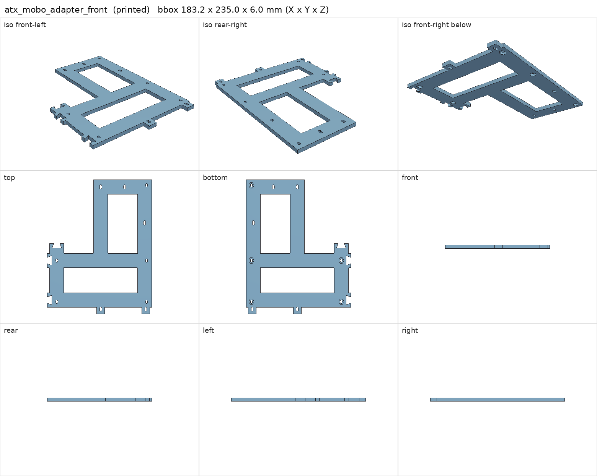

# atx_mobo_adapter_front

<!-- Generated by make check from part.toml. Edit part.toml, not this file. -->

| | |
| --- | --- |
| ID | `atx_mobo_adapter_front` |
| Category | printed |
| Print | plate `01_atx_mobo_adapter_front`, PETG |

## Used in

| Build | Qty | Status | Role |
| --- | ---: | --- | --- |
| [aipc](../../../aipc/parts/atx_mobo_adapter_front.md) | 2 | design | shelf-front motherboard section, common to both boards |

## Model

- [atx_mobo_adapter_front.step](atx_mobo_adapter_front.step) and [atx_mobo_adapter_front.stl](atx_mobo_adapter_front.stl)
- Source: generated. Exported by cad/shelf_layout.py in shelf coordinates; print/ re-orients it on the plate.
- Written by the `aipc` build's generator

## Datasheets

- None recorded. 

## Dimensions

| Key | Value | Evidence | Source / note |
| --- | --- | --- | --- |
| mass | 0.0937 kg | allowance | OrcaSlicer filament estimate |

## Interfaces

- provides `mobo-front-section` value ATX count 1 (allowance)

