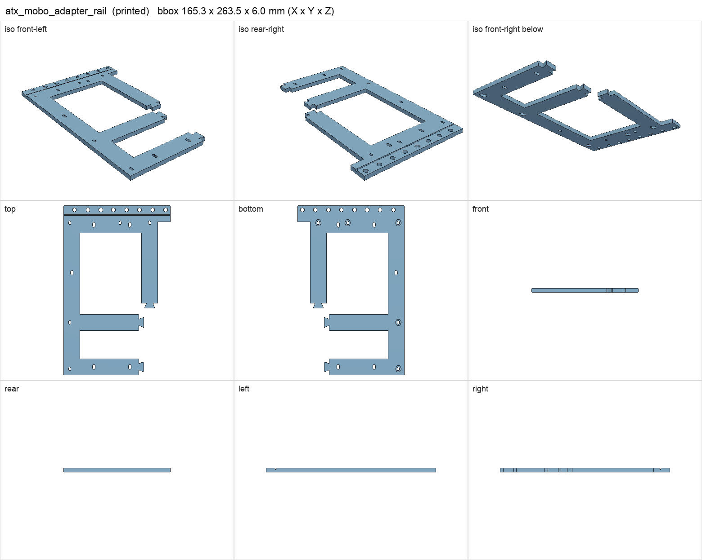

# atx_mobo_adapter_rail

<!-- Generated by make check from part.toml. Edit part.toml, not this file. -->

| | |
| --- | --- |
| ID | `atx_mobo_adapter_rail` |
| Category | printed |
| Print | PETG; plates are in each build's print/ |

## Used in

| Build | Qty | Status | Role |
| --- | ---: | --- | --- |
| [aipc](../../../aipc/parts/atx_mobo_adapter_rail.md) | 1 | design | Kenshin rear rail with GPU post holes at standard ATX positions |

## Model

- [atx_mobo_adapter_rail.step](atx_mobo_adapter_rail.step) and [atx_mobo_adapter_rail.stl](atx_mobo_adapter_rail.stl)
- Source: generated. Geometry from hwkit.components.atx_mobo_mount; exported by AIPC. Board-section frame as installed under AIPC's board, moved to the origin; print/ turns it over on the plate.
- Written by the `aipc` build's generator

## Datasheets

- None recorded. 

## Dimensions

| Key | Value | Evidence | Source / note |
| --- | --- | --- | --- |
| mass | 0.095 kg | allowance | OrcaSlicer filament estimate |

## Interfaces

- provides `mobo-rear-rail` value ATX standard slot positions count 1 (allowance)

