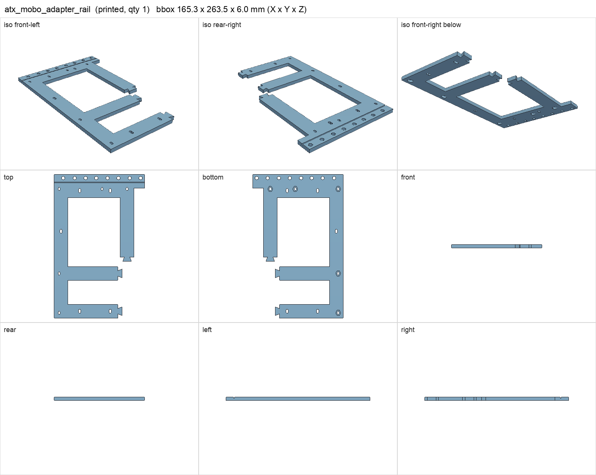
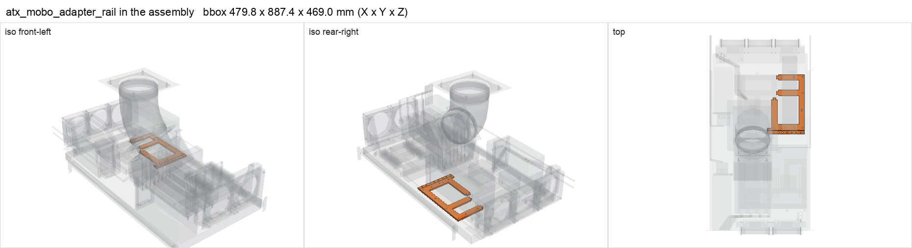

# atx_mobo_adapter_rail

<!-- Generated by make check from part.toml. Edit part.toml, not this file. -->

| | |
| --- | --- |
| ID | `atx_mobo_adapter_rail` |
| Category | printed |
| Role | Kenshin rear rail with GPU post holes at standard ATX positions |
| Status | design |
| Quantity | 1 |
| Systems | kenshin |
| Print | plate `02_atx_mobo_adapter_rail`, PETG |

## Model

- [atx_mobo_adapter_rail.step](atx_mobo_adapter_rail.step) and [atx_mobo_adapter_rail.stl](atx_mobo_adapter_rail.stl)
- Source: generated. Exported by cad/shelf_layout.py in shelf coordinates; print/ re-orients it on the plate.
- Assembly: 1 instances in the assembly

## Datasheets

- None recorded. 

## Dimensions

| Key | Value | Evidence | Source / note |
| --- | --- | --- | --- |
| mass | 0.095 kg | allowance | OrcaSlicer filament estimate |

## Interfaces

- provides `mobo-rear-rail` value ATX standard slot positions count 1 (allowance)

## Compatibility checks

| Status | Rule | Interface | Detail |
| --- | --- | --- | --- |
| BLOCKED | budget | `shelf-load` | load 23.1 kg of 39.0 kg x derate 1.0 = 39.0 kg (59% of rating); unknown load for ['fan-controller'] |
| provisional | value | `mobo-rear-rail` | gigabyte-x870e-aorus-pro needs ATX standard slot positions; provided by atx_mobo_adapter_rail |
| provisional | count | `mobo-rear-rail` | need 1 x mobo-rear-rail=atx standard slot positions, have 1 |

