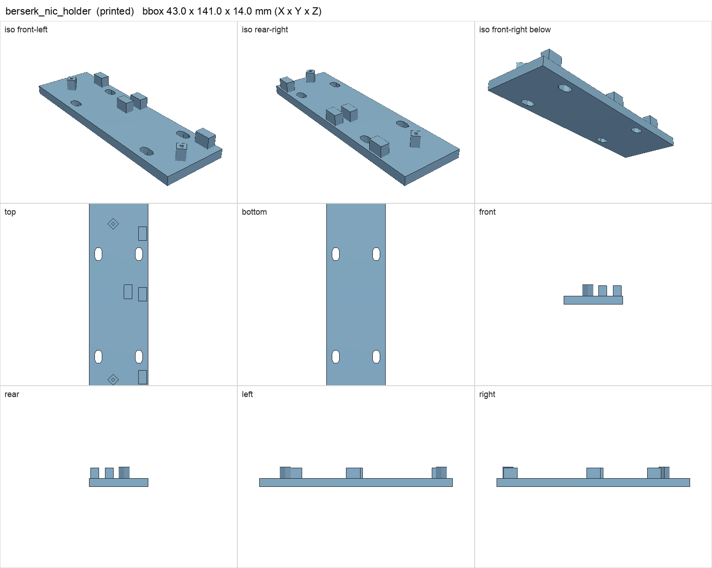

# berserk_nic_holder

<!-- Generated by make check from part.toml. Edit part.toml, not this file. -->

| | |
| --- | --- |
| ID | `berserk_nic_holder` |
| Category | printed |
| Print | PETG; plates are in each build's print/ |

PETG plate for the LRFC6911N riser: 6 mm base with four slotted M4 shelf
anchors and two 8 mm bosses under the slot-side holes of the owner-measured
35 x 114 mm pattern, which lift the board clear of its 5 mm-deep SATA
socket. The plate stops 2 mm short of Kenshin's mount rail and the riser
hangs 13.5 mm past it over the rail (owner, 2026-11-27: the side AIO's hoses
blocked the radiator-side position), so the socket-side holes stay empty;
four lands 0.5 mm under the board (beside the slot, and front, mid and rear
at the Kenshin edge) stop it flexing. Two anchors sit under the riser, so
the plate is bolted first. No bracket support (owner, 2026-11-19: the slot
holds the card). The first print (with a bracket gate) did not fit:
the riser's SATA socket sits under the board and the card has a full-height
bracket.

## Used in

| Build | Qty | Status | Role |
| --- | ---: | --- | --- |
| [aipc](../../../aipc/parts/berserk_nic_holder.md) | 1 | design | holds Berserk's LRFC6911N riser and ConnectX-4 Lx beside Kenshin's side AIO |

## Model

- [berserk_nic_holder.step](berserk_nic_holder.step) and [berserk_nic_holder.stl](berserk_nic_holder.stl)
- Source: generated. Exported by cad/shelf_layout.py in shelf coordinates; prints as installed, base on the bed.
- Written by the `aipc` build's generator

## Datasheets

- None recorded. 

## Dimensions

| Key | Value | Evidence | Source / note |
| --- | --- | --- | --- |
| mass | 0.0311 kg | allowance | OrcaSlicer filament estimate, plate 09, 2026-11-27 |

