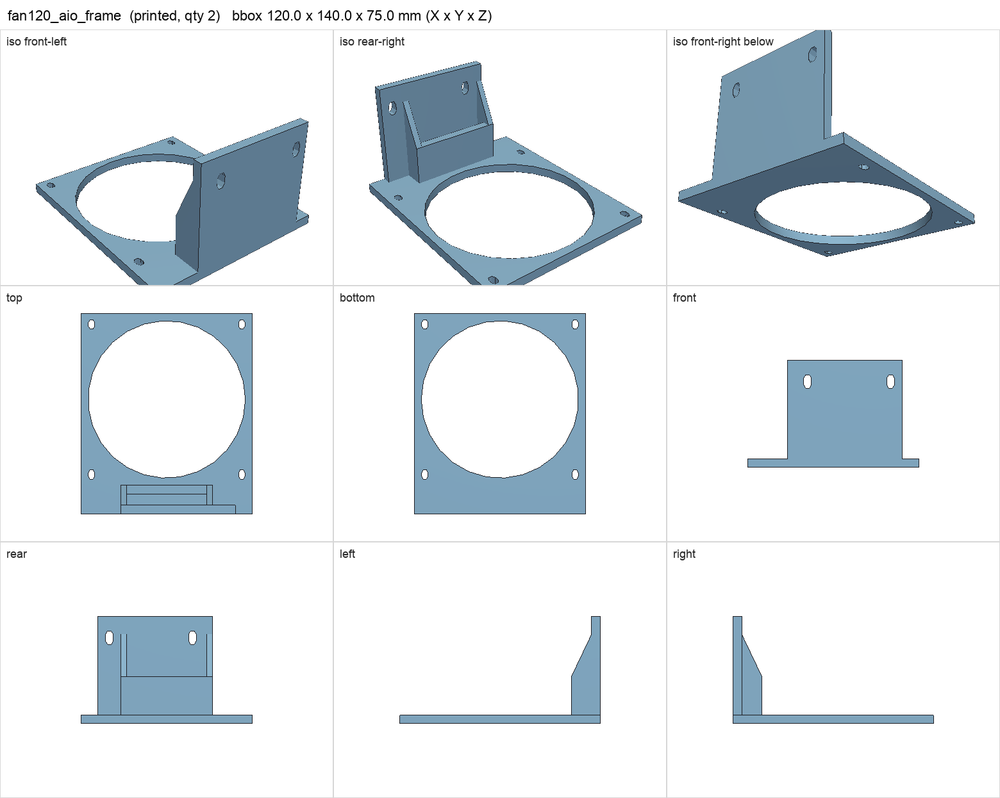
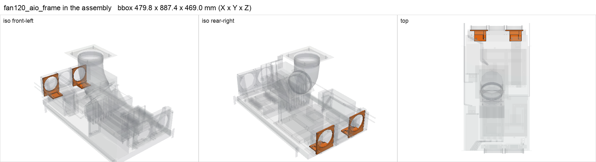

# fan120_aio_frame

<!-- Generated by make check from part.toml. Edit part.toml, not this file. -->

| | |
| --- | --- |
| ID | `fan120_aio_frame` |
| Category | printed |
| Role | 120 mm fan/radiator frame with 75 mm feet on the steel extension |
| Status | design |
| Quantity | 2 |
| Systems | kenshin |
| Print | plate `08_fan120_aio_frame`, PETG |

## Model

- [fan120_aio_frame.step](fan120_aio_frame.step) and [fan120_aio_frame.stl](fan120_aio_frame.stl)
- Source: generated. Exported by cad/shelf_layout.py in shelf coordinates; print/ re-orients it on the plate.
- Assembly: 2 instances in the assembly

## Datasheets

- None recorded. 

## Dimensions

| Key | Value | Evidence | Source / note |
| --- | --- | --- | --- |
| mass | 0.0796 kg | allowance | OrcaSlicer filament estimate |

## Interfaces

- provides `radiator-mount` value 360 mm, 105 mm pitch count 1 (allowance)

## Compatibility checks

| Status | Rule | Interface | Detail |
| --- | --- | --- | --- |
| BLOCKED | budget | `shelf-load` | load 23.2 kg of 39.0 kg x derate 1.0 = 39.0 kg (59% of rating); unknown load for ['fan-controller'] |
| provisional | value | `radiator-mount` | lian-li-ga2-lite-360 needs 360 mm, 105 mm pitch; provided by fan120_aio_frame |
| provisional | count | `radiator-mount` | need 2 x radiator-mount=360 mm, 105 mm pitch, have 2 |

