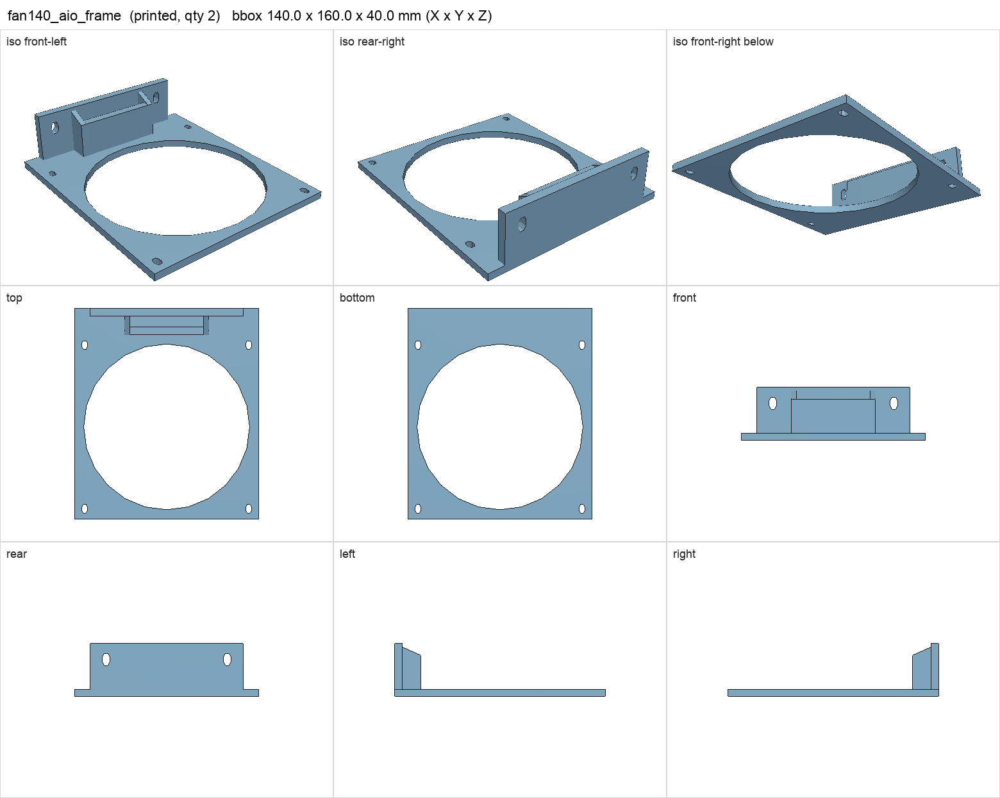
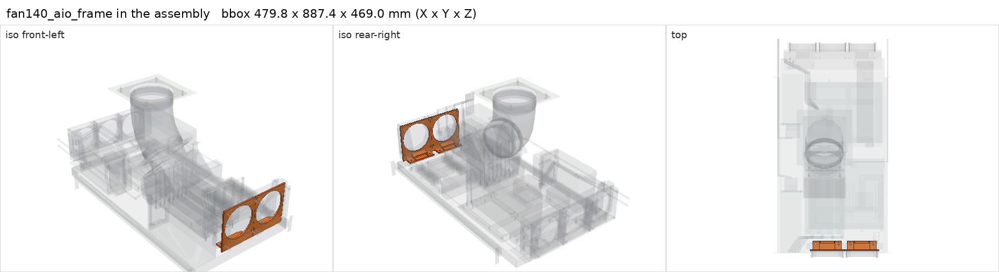

# fan140_aio_frame

<!-- Generated by make check from part.toml. Edit part.toml, not this file. -->

| | |
| --- | --- |
| ID | `fan140_aio_frame` |
| Category | printed |
| Role | 140 mm fan/radiator frame with bearing ledge (H115i) |
| Status | design |
| Quantity | 2 |
| Systems | berserk |
| Print | plate `06_fan140_aio_frame`, PETG |

## Model

- [fan140_aio_frame.step](fan140_aio_frame.step) and [fan140_aio_frame.stl](fan140_aio_frame.stl)
- Source: generated. Exported by cad/shelf_layout.py in shelf coordinates; print/ re-orients it on the plate.
- Assembly: 2 instances in the assembly

## Datasheets

- None recorded. 

## Dimensions

| Key | Value | Evidence | Source / note |
| --- | --- | --- | --- |
| mass | 0.076 kg | allowance | OrcaSlicer filament estimate |

## Interfaces

- provides `radiator-mount` value 280 mm, 124.5 mm pitch count 1 (allowance)

## Compatibility checks

| Status | Rule | Interface | Detail |
| --- | --- | --- | --- |
| provisional | value | `radiator-mount` | corsair-h115i needs 280 mm, 124.5 mm pitch; provided by fan140_aio_frame |
| provisional | count | `radiator-mount` | need 2 x radiator-mount=280 mm, 124.5 mm pitch, have 2 |
| provisional | budget | `shelf-load` | load 23.7 kg of 39.0 kg x derate 1.0 = 39.0 kg (61% of rating) |

