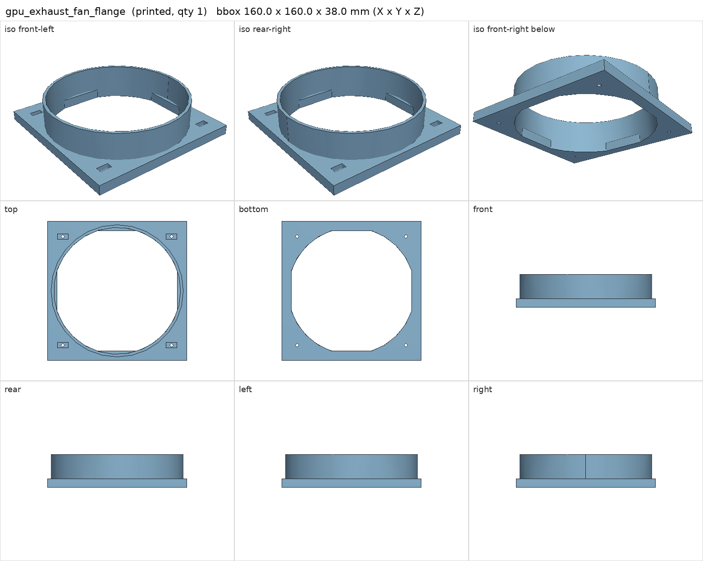
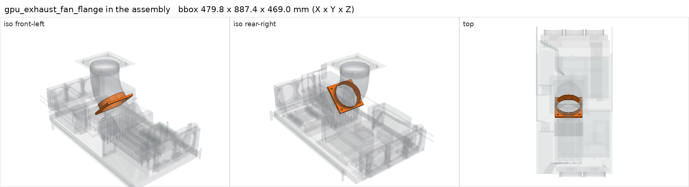

# gpu_exhaust_fan_flange

<!-- Generated by make check from part.toml. Edit part.toml, not this file. -->

| | |
| --- | --- |
| ID | `gpu_exhaust_fan_flange` |
| Category | printed |
| Role | fan outlet to 6 in duct |
| Status | design |
| Quantity | 1 |
| Systems | berserk |
| Print | plate `13_gpu_exhaust_fan_flange`, HT-PLA-GF |

## Model

- [gpu_exhaust_fan_flange.step](gpu_exhaust_fan_flange.step) and [gpu_exhaust_fan_flange.stl](gpu_exhaust_fan_flange.stl)
- Source: generated. Exported by cad/shelf_layout.py in shelf coordinates; print/ re-orients it on the plate.
- Assembly: 1 instances in the assembly

## Datasheets

- None recorded. 

## Dimensions

| Key | Value | Evidence | Source / note |
| --- | --- | --- | --- |
| mass | 0.129 kg | allowance | OrcaSlicer filament estimate |

## Interfaces

- provides `fan-mount` value 140 mm, 124.5 mm pitch count 1 (allowance)
- provides `duct-connection` value 6 in count 1 (allowance)

## Compatibility checks

| Status | Rule | Interface | Detail |
| --- | --- | --- | --- |
| BLOCKED | budget | `shelf-load` | load 23.2 kg of 39.0 kg x derate 1.0 = 39.0 kg (59% of rating); unknown load for ['fan-controller'] |
| provisional | value | `duct-connection` | flex-duct-6in needs 6 in; provided by gpu_exhaust_fan_flange, gpu_exhaust_roof_flange |
| provisional | count | `duct-connection` | need 2 x duct-connection=6 in, have 2 |
| provisional | value | `fan-mount` | sanyo-denki-9gv1412p1s001 needs 140 mm, 124.5 mm pitch; provided by gpu_exhaust_fan_flange, v100_gpu_shroud |
| provisional | count | `fan-mount` | need 2 x fan-mount=140 mm, 124.5 mm pitch, have 2 |

