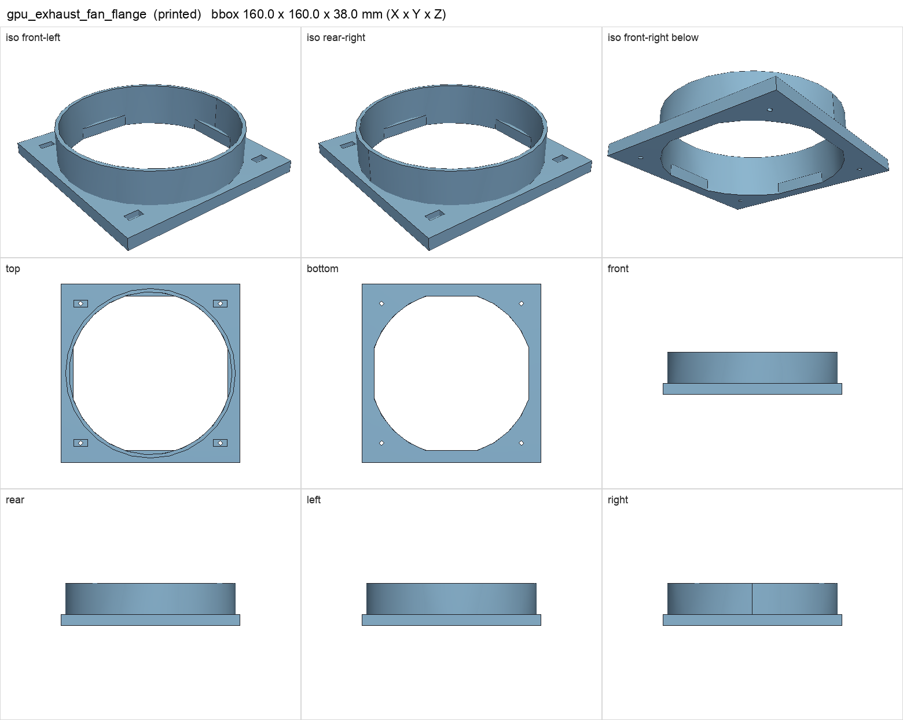

# gpu_exhaust_fan_flange

<!-- Generated by make check from part.toml. Edit part.toml, not this file. -->

| | |
| --- | --- |
| ID | `gpu_exhaust_fan_flange` |
| Category | printed |
| Print | HT-PLA-GF; plates are in each build's print/ |

## Used in

| Build | Qty | Status | Role |
| --- | ---: | --- | --- |
| [aipc](../../../aipc/parts/gpu_exhaust_fan_flange.md) | 1 | design | fan outlet to 6 in duct |

## Model

- [gpu_exhaust_fan_flange.step](gpu_exhaust_fan_flange.step) and [gpu_exhaust_fan_flange.stl](gpu_exhaust_fan_flange.stl)
- Source: generated. Exported by cad/shelf_layout.py in shelf coordinates; print/ re-orients it on the plate.
- Written by the `aipc` build's generator

## Datasheets

- None recorded. 

## Dimensions

| Key | Value | Evidence | Source / note |
| --- | --- | --- | --- |
| mass | 0.129 kg | allowance | OrcaSlicer filament estimate |

## Interfaces

- provides `fan-mount` value 140 mm, 124.5 mm pitch count 1 (allowance)
- provides `duct-connection` value 6 in count 1 (allowance)

