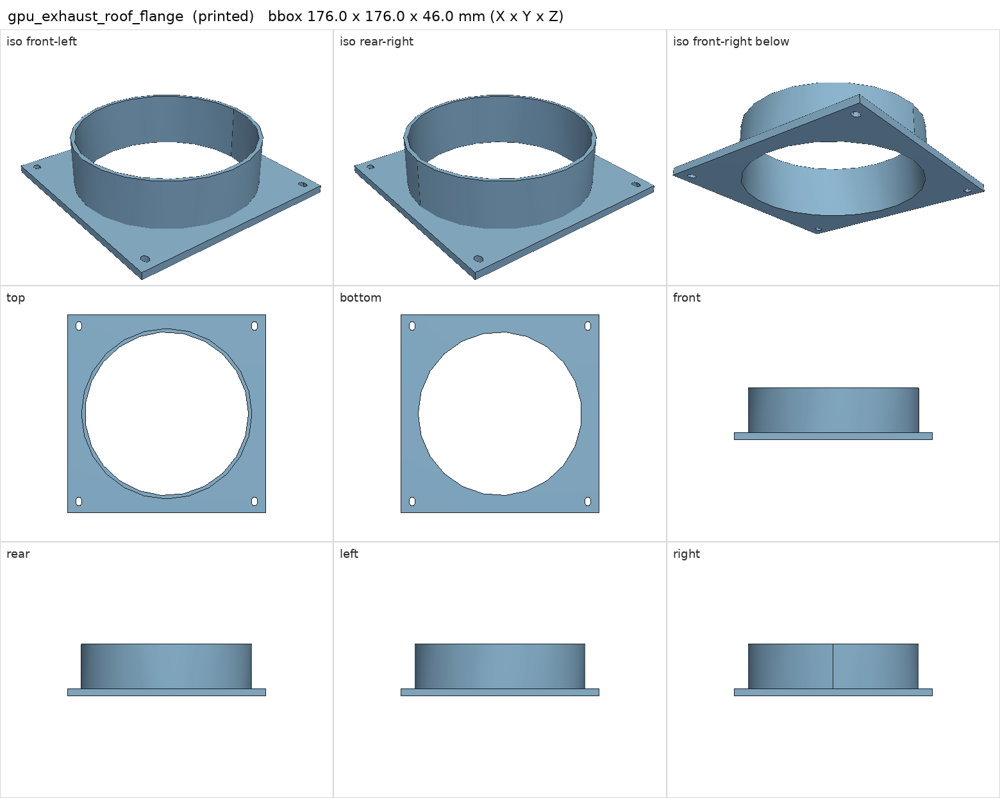

# gpu_exhaust_roof_flange

<!-- Generated by make check from part.toml. Edit part.toml, not this file. -->

| | |
| --- | --- |
| ID | `gpu_exhaust_roof_flange` |
| Category | printed |
| Print | plate `14_gpu_exhaust_roof_flange`, HT-PLA-GF |

## Used in

| Build | Qty | Status | Role |
| --- | ---: | --- | --- |
| [aipc](../../../aipc/parts/gpu_exhaust_roof_flange.md) | 1 | design | duct to cabinet inner ceiling |

## Model

- [gpu_exhaust_roof_flange.step](gpu_exhaust_roof_flange.step) and [gpu_exhaust_roof_flange.stl](gpu_exhaust_roof_flange.stl)
- Source: generated. Exported by cad/shelf_layout.py in shelf coordinates; print/ re-orients it on the plate.
- Written by the `aipc` build's generator

## Datasheets

- None recorded. 

## Dimensions

| Key | Value | Evidence | Source / note |
| --- | --- | --- | --- |
| mass | 0.1487 kg | allowance | OrcaSlicer filament estimate |

## Interfaces

- provides `duct-connection` value 6 in count 1 (allowance)

