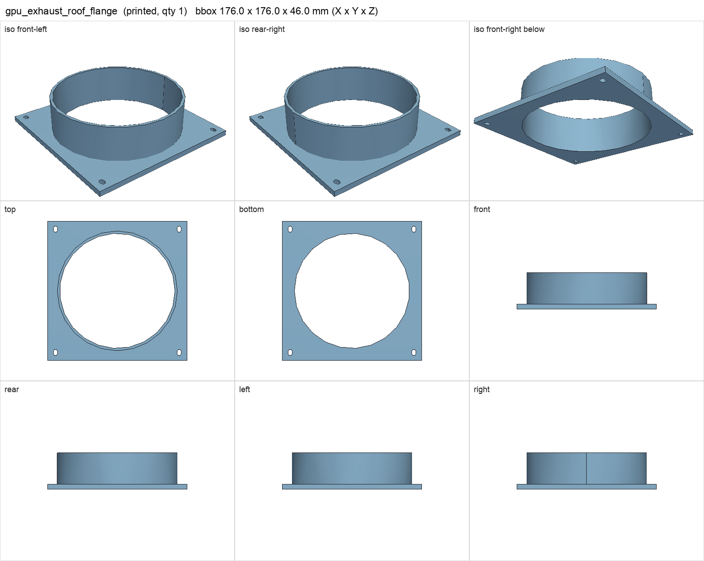
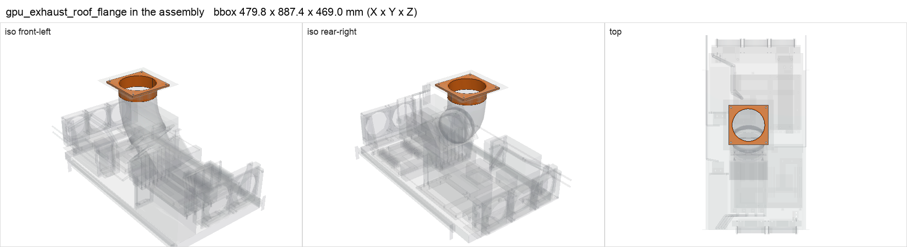

# gpu_exhaust_roof_flange

<!-- Generated by make check from part.toml. Edit part.toml, not this file. -->

| | |
| --- | --- |
| ID | `gpu_exhaust_roof_flange` |
| Category | printed |
| Role | duct to cabinet inner ceiling |
| Status | design |
| Quantity | 1 |
| Systems | berserk |
| Print | plate `14_gpu_exhaust_roof_flange`, HT-PLA-GF |

## Model

- [gpu_exhaust_roof_flange.step](gpu_exhaust_roof_flange.step) and [gpu_exhaust_roof_flange.stl](gpu_exhaust_roof_flange.stl)
- Source: generated. Exported by cad/shelf_layout.py in shelf coordinates; print/ re-orients it on the plate.
- Assembly: 1 instances in the assembly

## Datasheets

- None recorded. 

## Dimensions

| Key | Value | Evidence | Source / note |
| --- | --- | --- | --- |
| mass | 0.1487 kg | allowance | OrcaSlicer filament estimate |

## Interfaces

- provides `duct-connection` value 6 in count 1 (allowance)

## Compatibility checks

| Status | Rule | Interface | Detail |
| --- | --- | --- | --- |
| provisional | value | `duct-connection` | flex-duct-6in needs 6 in; provided by gpu_exhaust_fan_flange, gpu_exhaust_roof_flange |
| provisional | count | `duct-connection` | need 2 x duct-connection=6 in, have 2 |

