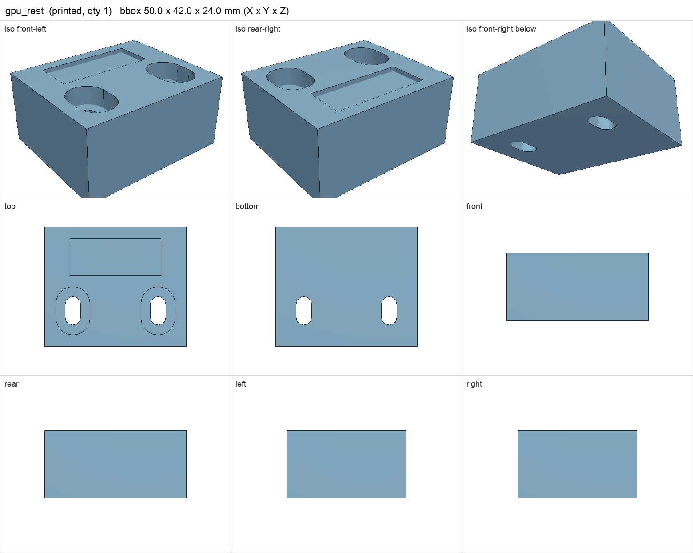
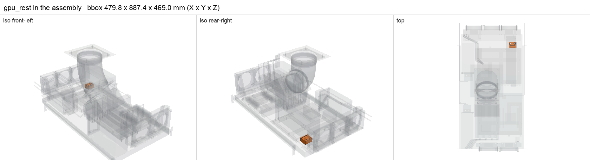

# gpu_rest

<!-- Generated by make check from part.toml. Edit part.toml, not this file. -->

| | |
| --- | --- |
| ID | `gpu_rest` |
| Category | printed |
| Role | front-end rest for the RTX 5090 |
| Status | design |
| Quantity | 1 |
| Systems | kenshin |
| Print | plate `04_gpu_rest`, PETG |

## Model

- [gpu_rest.step](gpu_rest.step) and [gpu_rest.stl](gpu_rest.stl)
- Source: generated. Exported by cad/shelf_layout.py in shelf coordinates; print/ re-orients it on the plate.
- Assembly: 1 instances in the assembly

## Datasheets

- None recorded. 

## Dimensions

| Key | Value | Evidence | Source / note |
| --- | --- | --- | --- |
| mass | 0.0319 kg | allowance | OrcaSlicer filament estimate |

## Compatibility checks

| Status | Rule | Interface | Detail |
| --- | --- | --- | --- |
| BLOCKED | budget | `shelf-load` | load 23.2 kg of 39.0 kg x derate 1.0 = 39.0 kg (59% of rating); unknown load for ['fan-controller'] |

