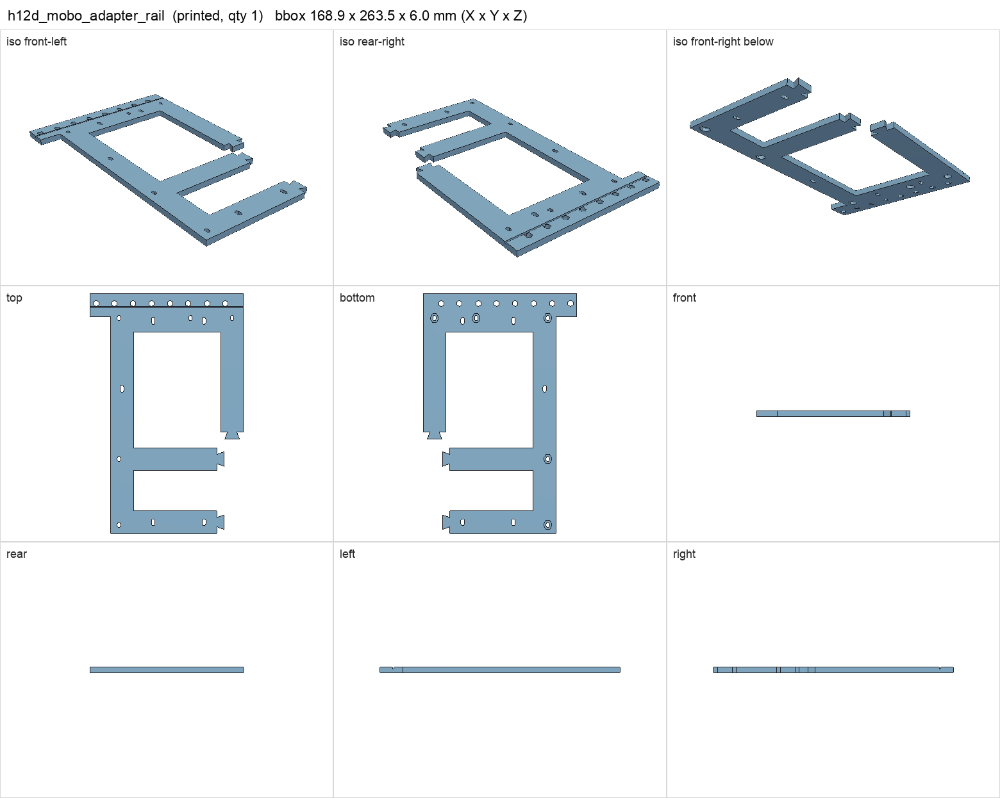
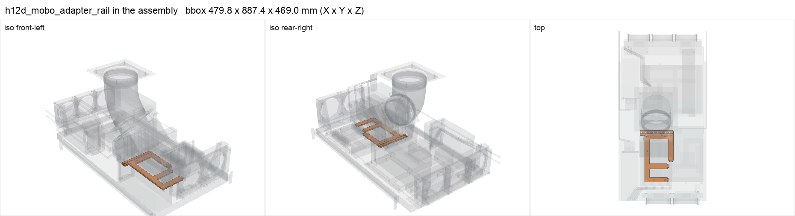

# h12d_mobo_adapter_rail

<!-- Generated by make check from part.toml. Edit part.toml, not this file. -->

| | |
| --- | --- |
| ID | `h12d_mobo_adapter_rail` |
| Category | printed |
| Role | Berserk rear rail with GPU post holes for four dual-slot V100s |
| Status | design |
| Quantity | 1 |
| Systems | berserk |
| Print | plate `03_h12d_mobo_adapter_rail`, PETG |

## Model

- [h12d_mobo_adapter_rail.step](h12d_mobo_adapter_rail.step) and [h12d_mobo_adapter_rail.stl](h12d_mobo_adapter_rail.stl)
- Source: generated. Exported by cad/shelf_layout.py in shelf coordinates; print/ re-orients it on the plate.
- Assembly: 1 instances in the assembly

## Datasheets

- None recorded. 

## Dimensions

| Key | Value | Evidence | Source / note |
| --- | --- | --- | --- |
| mass | 0.0952 kg | allowance | OrcaSlicer filament estimate |

## Interfaces

- provides `mobo-rear-rail` value H12D-8D slot positions count 1 (allowance)

## Compatibility checks

| Status | Rule | Interface | Detail |
| --- | --- | --- | --- |
| provisional | value | `mobo-rear-rail` | huananzhi-h12d-8d needs H12D-8D slot positions; provided by h12d_mobo_adapter_rail |
| provisional | count | `mobo-rear-rail` | need 1 x mobo-rear-rail=h12d-8d slot positions, have 1 |
| provisional | budget | `shelf-load` | load 23.7 kg of 39.0 kg x derate 1.0 = 39.0 kg (61% of rating) |

