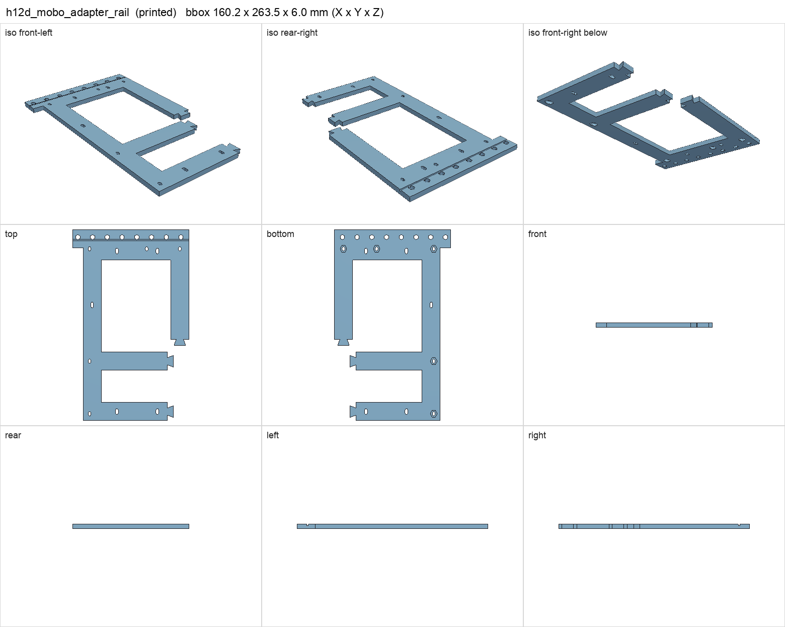

# h12d_mobo_adapter_rail

<!-- Generated by make check from part.toml. Edit part.toml, not this file. -->

| | |
| --- | --- |
| ID | `h12d_mobo_adapter_rail` |
| Category | printed |
| Print | PETG; plates are in each build's print/ |

## Used in

| Build | Qty | Status | Role |
| --- | ---: | --- | --- |
| [aipc](../../../aipc/parts/h12d_mobo_adapter_rail.md) | 1 | design | Berserk rear rail with GPU post holes for four dual-slot V100s |
| [gpulab](../../../gpulab/parts/h12d_mobo_adapter_rail.md) | 1 | design | H12D-8D mount section with the I/O-side rail, reused from AIPC (Berserk); its V100 post holes stay empty |

## Model

- [h12d_mobo_adapter_rail.step](h12d_mobo_adapter_rail.step) and [h12d_mobo_adapter_rail.stl](h12d_mobo_adapter_rail.stl)
- Source: generated. Geometry from hwkit.components.atx_mobo_mount; exported by AIPC. Board-section frame as installed under AIPC's board, moved to the origin; print/ turns it over on the plate.
- Written by the `aipc` build's generator

## Datasheets

- None recorded. 

## Dimensions

| Key | Value | Evidence | Source / note |
| --- | --- | --- | --- |
| mass | 0.0952 kg | allowance | OrcaSlicer filament estimate |

## Interfaces

- provides `mobo-rear-rail` value H12D-8D slot positions count 1 (allowance)

