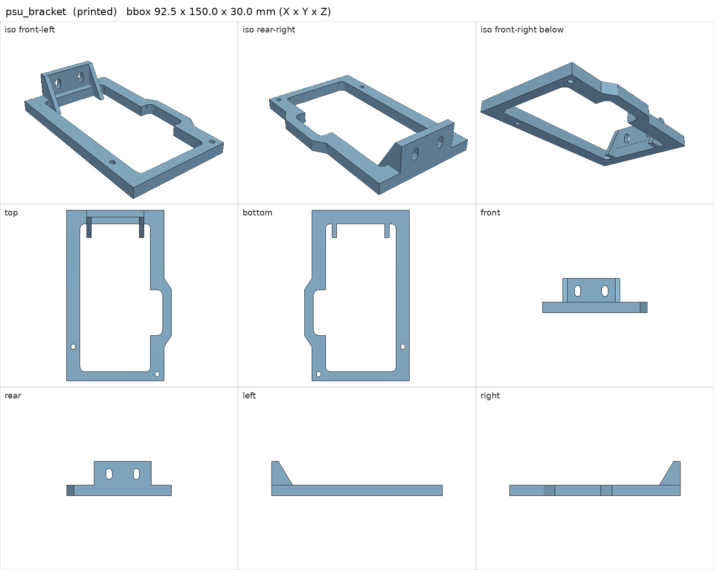

# psu_bracket

<!-- Generated by make check from part.toml. Edit part.toml, not this file. -->

| | |
| --- | --- |
| ID | `psu_bracket` |
| Category | printed |
| Print | plate `05_psu_brackets`, HT-PLA-GF |

## Used in

| Build | Qty | Status | Role |
| --- | ---: | --- | --- |
| [aipc](../../../aipc/parts/psu_bracket.md) | 2 | design | rear restraint for an 86 x 150 mm ATX PSU face |

## Model

- [psu_bracket.step](psu_bracket.step) and [psu_bracket.stl](psu_bracket.stl)
- Source: generated. Exported by cad/shelf_layout.py in shelf coordinates; print/ re-orients it on the plate.
- Written by the `aipc` build's generator

## Datasheets

- None recorded. 

## Dimensions

| Key | Value | Evidence | Source / note |
| --- | --- | --- | --- |
| mass | 0.0472 kg | allowance | OrcaSlicer filament estimate |

## Interfaces

- provides `psu-restraint` value ATX 150 x 86 face count 1 (allowance)

