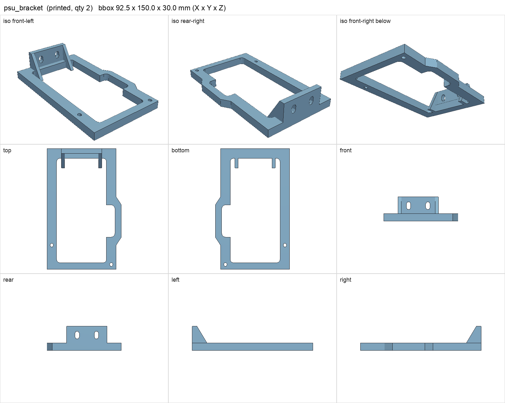
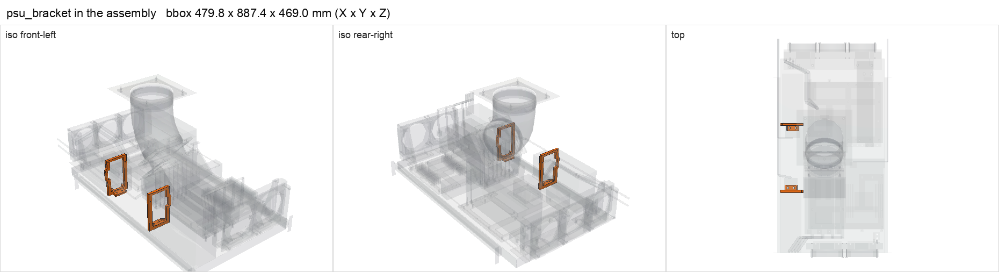

# psu_bracket

<!-- Generated by make check from part.toml. Edit part.toml, not this file. -->

| | |
| --- | --- |
| ID | `psu_bracket` |
| Category | printed |
| Role | rear restraint for an 86 x 150 mm ATX PSU face |
| Status | design |
| Quantity | 2 |
| Systems | berserk, kenshin |
| Print | plate `05_psu_brackets`, HT-PLA-GF |

## Model

- [psu_bracket.step](psu_bracket.step) and [psu_bracket.stl](psu_bracket.stl)
- Source: generated. Exported by cad/shelf_layout.py in shelf coordinates; print/ re-orients it on the plate.
- Assembly: 2 instances in the assembly

## Datasheets

- None recorded. 

## Dimensions

| Key | Value | Evidence | Source / note |
| --- | --- | --- | --- |
| mass | 0.0472 kg | allowance | OrcaSlicer filament estimate |

## Interfaces

- provides `psu-restraint` value ATX 150 x 86 face count 1 (allowance)

## Compatibility checks

| Status | Rule | Interface | Detail |
| --- | --- | --- | --- |
| provisional | value | `psu-restraint` | corsair-hx1200i needs ATX 150 x 86 face; provided by psu_bracket |
| provisional | value | `psu-restraint` | rosewill-hercules-1600 needs ATX 150 x 86 face; provided by psu_bracket |
| provisional | count | `psu-restraint` | need 2 x psu-restraint=atx 150 x 86 face, have 2 |
| provisional | budget | `shelf-load` | load 23.3 kg of 39.0 kg x derate 1.0 = 39.0 kg (60% of rating) |

