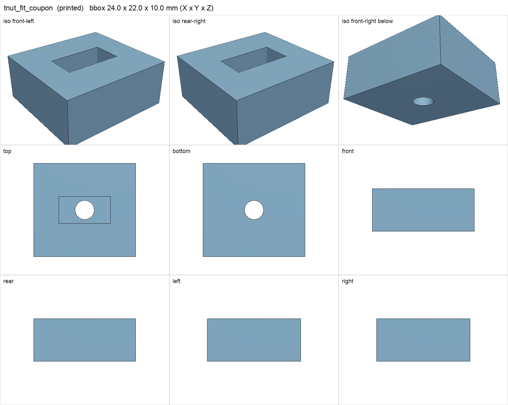

# tnut_fit_coupon

<!-- Generated by make check from part.toml. Edit part.toml, not this file. -->

| | |
| --- | --- |
| ID | `tnut_fit_coupon` |
| Category | printed |
| Print | HT-PLA-GF; plates are in each build's print/ |

## Used in

| Build | Qty | Status | Role |
| --- | ---: | --- | --- |
| [aipc](../../../aipc/parts/tnut_fit_coupon.md) | 1 | design | test print for the M4 hammer T-nut pocket |

## Model

- [tnut_fit_coupon.step](tnut_fit_coupon.step) and [tnut_fit_coupon.stl](tnut_fit_coupon.stl)
- Source: generated. Exported by cad/shelf_layout.py in shelf coordinates; print/ re-orients it on the plate.
- Written by the `aipc` build's generator

## Datasheets

- None recorded. 

## Dimensions

| Key | Value | Evidence | Source / note |
| --- | --- | --- | --- |
| mass | 0.0048 kg | allowance | OrcaSlicer filament estimate |

