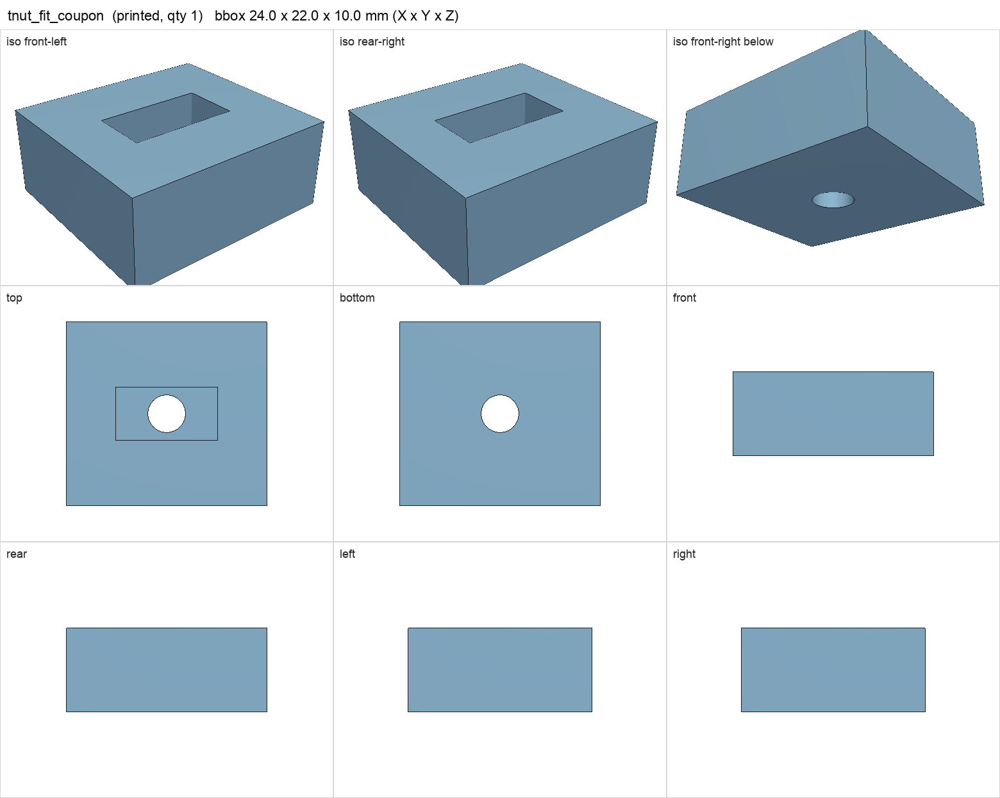

# tnut_fit_coupon

<!-- Generated by make check from part.toml. Edit part.toml, not this file. -->

| | |
| --- | --- |
| ID | `tnut_fit_coupon` |
| Category | printed |
| Role | test print for the M4 hammer T-nut pocket |
| Status | design |
| Quantity | 1 |
| Systems | berserk |
| Print | plate `11_tnut_fit_coupon`, HT-PLA-GF |

## Model

- [tnut_fit_coupon.step](tnut_fit_coupon.step) and [tnut_fit_coupon.stl](tnut_fit_coupon.stl)
- Source: generated. Exported by cad/shelf_layout.py in shelf coordinates; print/ re-orients it on the plate.
- Assembly: **not in the assembly**: fit coupon, not installed

## Datasheets

- None recorded. 

## Dimensions

| Key | Value | Evidence | Source / note |
| --- | --- | --- | --- |
| mass | 0.0048 kg | allowance | OrcaSlicer filament estimate |

