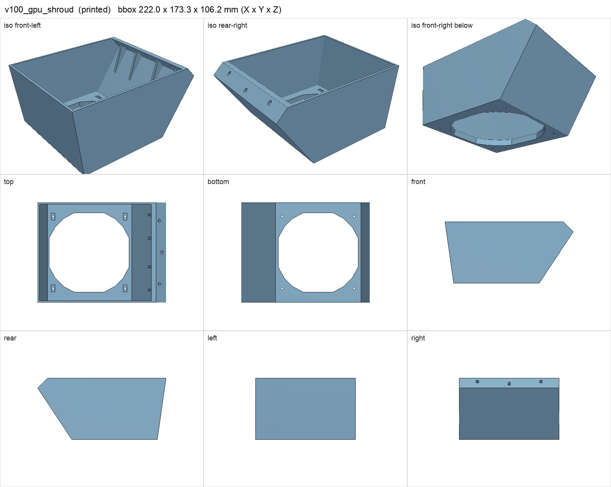

# v100_gpu_shroud

<!-- Generated by make check from part.toml. Edit part.toml, not this file. -->

| | |
| --- | --- |
| ID | `v100_gpu_shroud` |
| Category | printed |
| Print | HT-PLA-GF; plates are in each build's print/ |

## Used in

| Build | Qty | Status | Role |
| --- | ---: | --- | --- |
| [aipc](../../../aipc/parts/v100_gpu_shroud.md) | 1 | design | hood over the four V100s with integral 45 degree fan panel |

## Model

- [v100_gpu_shroud.step](v100_gpu_shroud.step) and [v100_gpu_shroud.stl](v100_gpu_shroud.stl)
- Source: generated. Exported by cad/shelf_layout.py in shelf coordinates; print/ re-orients it on the plate.
- Written by the `aipc` build's generator

## Datasheets

- None recorded. 

## Dimensions

| Key | Value | Evidence | Source / note |
| --- | --- | --- | --- |
| mass | 0.4036 kg | allowance | OrcaSlicer filament estimate |

## Interfaces

- provides `fan-mount` value 140 mm, 124.5 mm pitch count 1 (allowance)

