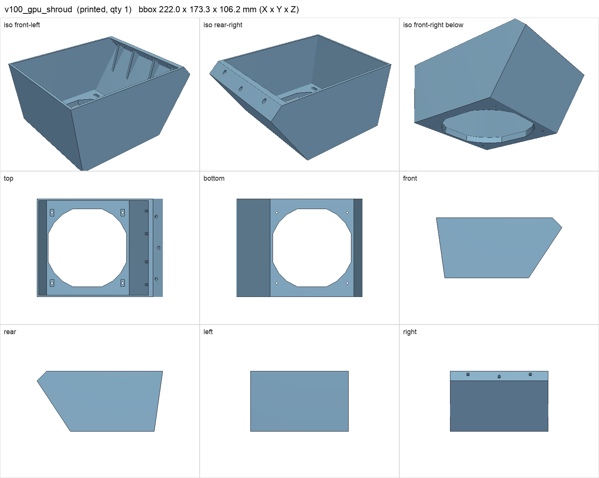
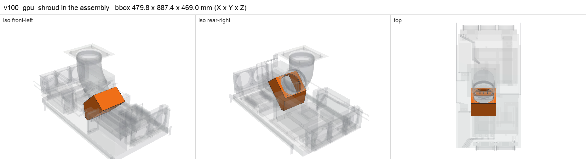

# v100_gpu_shroud

<!-- Generated by make check from part.toml. Edit part.toml, not this file. -->

| | |
| --- | --- |
| ID | `v100_gpu_shroud` |
| Category | printed |
| Role | hood over the four V100s with integral 45 degree fan panel |
| Status | design |
| Quantity | 1 |
| Systems | berserk |
| Print | plate `12_v100_gpu_shroud`, HT-PLA-GF |

## Model

- [v100_gpu_shroud.step](v100_gpu_shroud.step) and [v100_gpu_shroud.stl](v100_gpu_shroud.stl)
- Source: generated. Exported by cad/shelf_layout.py in shelf coordinates; print/ re-orients it on the plate.
- Assembly: 1 instances in the assembly

## Datasheets

- None recorded. 

## Dimensions

| Key | Value | Evidence | Source / note |
| --- | --- | --- | --- |
| mass | 0.4036 kg | allowance | OrcaSlicer filament estimate |

## Interfaces

- provides `fan-mount` value 140 mm, 124.5 mm pitch count 1 (allowance)

## Compatibility checks

| Status | Rule | Interface | Detail |
| --- | --- | --- | --- |
| BLOCKED | budget | `shelf-load` | load 23.1 kg of 39.0 kg x derate 1.0 = 39.0 kg (59% of rating); unknown load for ['fan-controller'] |
| provisional | value | `fan-mount` | sanyo-denki-9gv1412p1s001 needs 140 mm, 124.5 mm pitch; provided by gpu_exhaust_fan_flange, v100_gpu_shroud |
| provisional | count | `fan-mount` | need 2 x fan-mount=140 mm, 124.5 mm pitch, have 2 |

