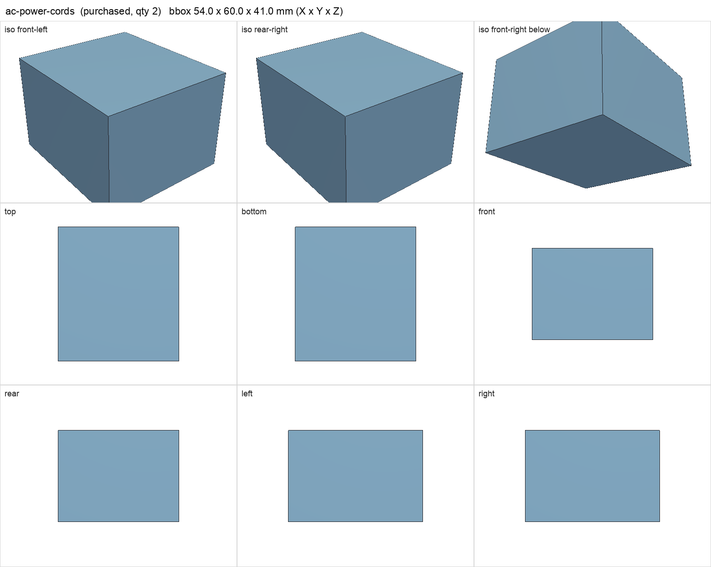
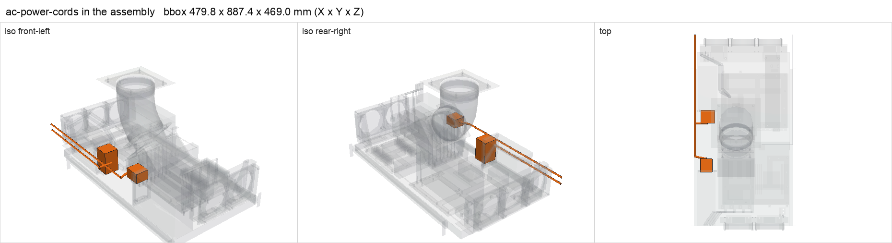

# AC power cords

<!-- Generated by make check from part.toml. Edit part.toml, not this file. -->

| | |
| --- | --- |
| ID | `ac-power-cords` |
| Category | purchased |
| Role | PSU mains cords |
| Status | candidate |
| Quantity | 2 |
| Systems | berserk, kenshin |

## Model

- [ac-power-cords.step](ac-power-cords.step)
- Source: constructed. Plug bodies and route segments are survey envelopes.
- Assembly: 6 instances in the assembly

## Datasheets

- None recorded. Not selected. HX1200i wants a low-profile or down-exit C13; match the Hercules inlet and the UPS outlet (possibly C19).

