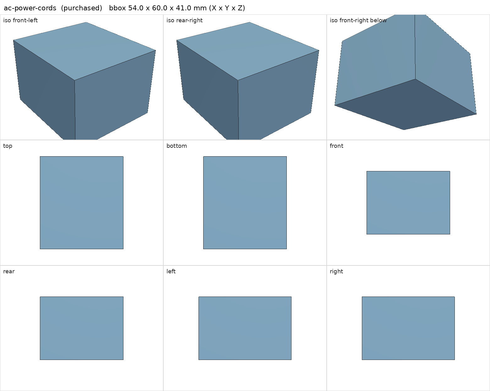

# AC power cords

<!-- Generated by make check from part.toml. Edit part.toml, not this file. -->

| | |
| --- | --- |
| ID | `ac-power-cords` |
| Category | purchased |

## Used in

| Build | Qty | Status | Role |
| --- | ---: | --- | --- |
| [aipc](../../../aipc/parts/ac-power-cords.md) | 2 | candidate | PSU mains cords |

## Model

- [ac-power-cords.step](ac-power-cords.step)
- Source: constructed. Plug bodies and route segments are survey envelopes.
- Written by the `aipc` build's generator

## Datasheets

- None recorded. Not selected. HX1200i wants a low-profile or down-exit C13; match the Hercules inlet and the UPS outlet (possibly C19).

