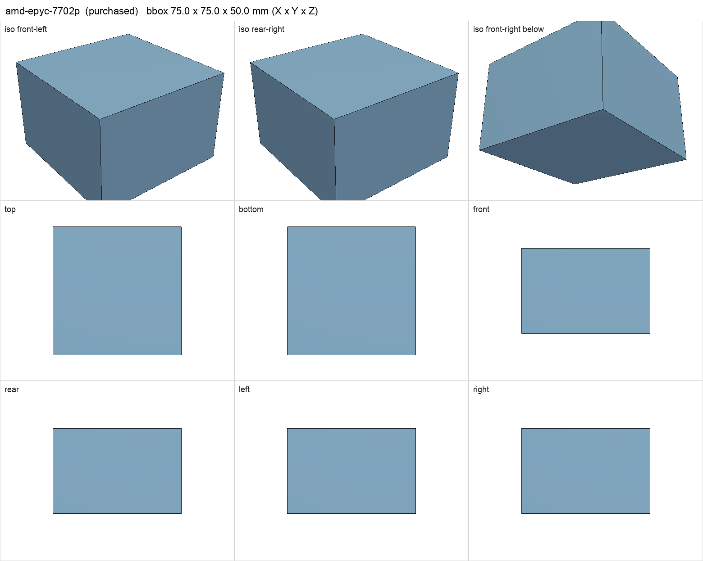

# AMD EPYC 7702P

<!-- Generated by make check from part.toml. Edit part.toml, not this file. -->

| | |
| --- | --- |
| ID | `amd-epyc-7702p` |
| Category | purchased |

## Used in

| Build | Qty | Status | Role |
| --- | ---: | --- | --- |
| [aipc](../../../aipc/parts/amd-epyc-7702p.md) | 1 | owned | Berserk CPU |
| [gpulab](../../../gpulab/parts/amd-epyc-7702p.md) | 1 | candidate | node CPU (same model as Berserk's) |

## Model

- [amd-epyc-7702p.step](amd-epyc-7702p.step)
- Source: constructed. 75 x 75 x 50 mm CPU-plus-pump survey envelope at the photo-estimated socket centre.
- Written by the `aipc` build's generator

## Datasheets

- [AMD EPYC 7702P specifications](https://www.amd.com/en/products/processors/server/epyc/7002-series/amd-epyc-7702p.html)
- Local copies: `datasheets/` after `make datasheets` (not committed)

## Dimensions

| Key | Value | Evidence | Source / note |
| --- | --- | --- | --- |
| tdp | 200 W | datasheet | AMD specifications |
| mass | 0.1 kg | assumed |  |

## Interfaces

- requires `cpu-socket` value SP3 (datasheet)
- requires `cooler-mount` value SP3 (datasheet) — the SP3 IHS is far larger than a round desktop cold plate
- requires `dc-power` load 200 (datasheet)

