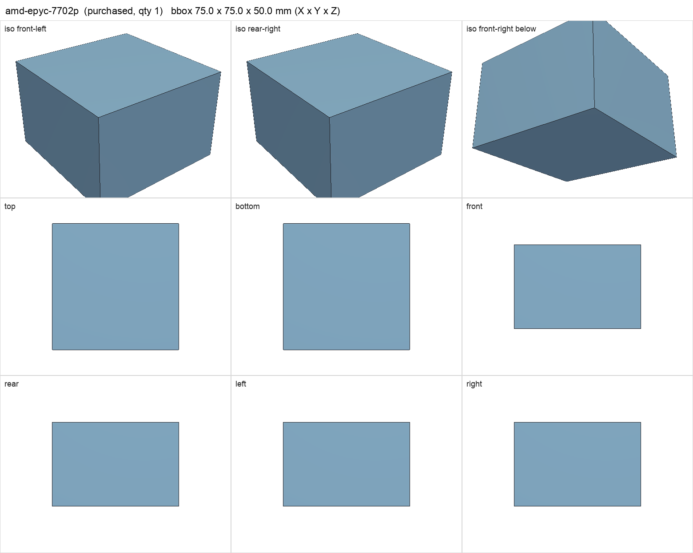
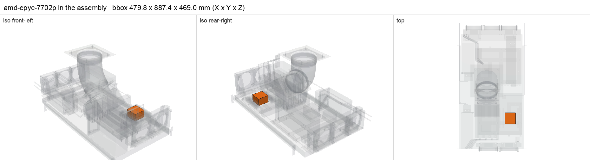

# AMD EPYC 7702P

<!-- Generated by make check from part.toml. Edit part.toml, not this file. -->

| | |
| --- | --- |
| ID | `amd-epyc-7702p` |
| Category | purchased |
| Role | Berserk CPU |
| Status | selected |
| Quantity | 1 |
| Systems | berserk |

Bundled with the H12D listing. The assembly envelope includes the cooler pump head.

## Model

- [amd-epyc-7702p.step](amd-epyc-7702p.step)
- Source: constructed. 75 x 75 x 50 mm CPU-plus-pump survey envelope at the photo-estimated socket centre.
- Assembly: 1 instances in the assembly

## Datasheets

- [AMD EPYC 7702P specifications](https://www.amd.com/en/products/processors/server/epyc/7002-series/amd-epyc-7702p.html)
- Local copies: `datasheets/` after `make datasheets` (not committed)

## Dimensions

| Key | Value | Evidence | Source / note |
| --- | --- | --- | --- |
| tdp | 200 W | datasheet | AMD specifications |
| mass | 0.1 kg | assumed |  |

## Interfaces

- requires `cpu-socket` value SP3 (datasheet)
- requires `cooler-mount` value SP3 (datasheet) — the SP3 IHS is far larger than a round desktop cold plate
- requires `dc-power` load 200 (datasheet)

## Compatibility checks

| Status | Rule | Interface | Detail |
| --- | --- | --- | --- |
| BLOCKED | budget | `shelf-load` | load 23.2 kg of 39.0 kg x derate 1.0 = 39.0 kg (59% of rating); unknown load for ['fan-controller'] |
| provisional | value | `cooler-mount` | amd-epyc-7702p needs SP3; provided by asetek-tr4-bracket |
| provisional | budget | `dc-power` | load 1090.2 W of 1600.0 W x derate 0.8 = 1280.0 W (68% of rating); relies on configured limits of ['nvidia-v100-pcie-16gb']; unlimited peak 1370.2 W |
| pass | value | `cpu-socket` | amd-epyc-7702p needs SP3; provided by huananzhi-h12d-8d |

