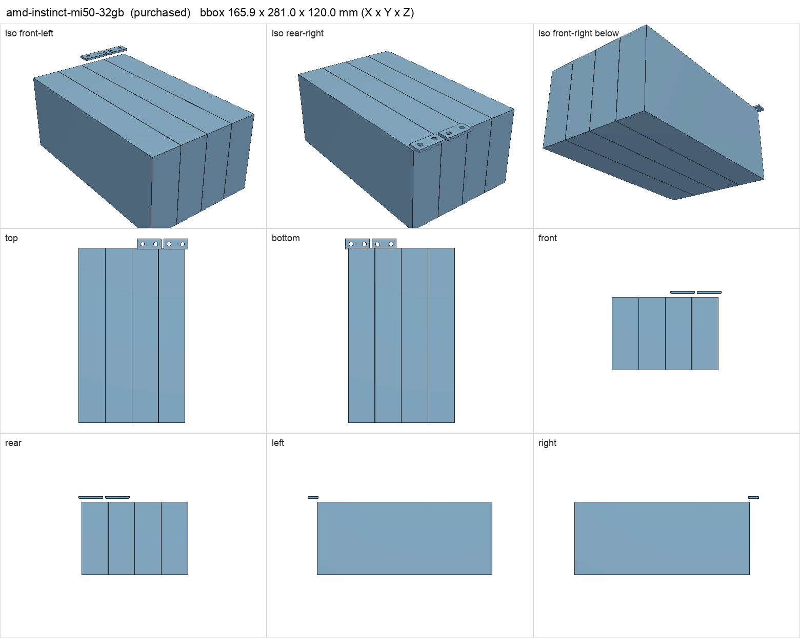

# AMD Radeon Instinct MI50 32 GB

<!-- Generated by make check from part.toml. Edit part.toml, not this file. -->

| | |
| --- | --- |
| ID | `amd-instinct-mi50-32gb` |
| Category | purchased |
| Product | <https://www.amd.com/en/support/downloads/drivers.html/accelerators/instinct/instinct-mi-series/instinct-mi50-32gb.html> |

Passive 300 W Vega20 (gfx906) accelerator: it needs forced ducted airflow, like
the V100. AMD lists the 16 GB and 32 GB boards with the same length, height,
width, power and connectors; only the HBM2 size differs. Auxiliary power is
two standard PCIe 8-pin sockets (no EPS adapter). AMD gives the height only
as "full height", the width only as "double slot" and no mass; the power
socket position, bracket and flange holes are not published. gfx906 is out of
official support in current ROCm releases; check the ROCm version you plan to
run before buying. Many used boards are resold with reflashed VBIOS; check the
one you buy.

## Used in

| Build | Qty | Status | Role |
| --- | ---: | --- | --- |
| [aipc](../../../aipc/parts/amd-instinct-mi50-32gb.md) | 4 | selected | Berserk GPUs (passive, ducted) |

## Model

- [amd-instinct-mi50-32gb.step](amd-instinct-mi50-32gb.step)
- Source: constructed. Body envelope only: length x height x thickness.
- Written by the `aipc` build's generator

## Datasheets

- [AMD Instinct MI50 (32GB) specifications](https://www.amd.com/en/support/downloads/drivers.html/accelerators/instinct/instinct-mi-series/instinct-mi50-32gb.html)
- Local copies: `datasheets/` after `make datasheets` (not committed)

## Dimensions

| Key | Value | Evidence | Source / note |
| --- | --- | --- | --- |
| length | 267 mm | datasheet | AMD specifications: board length 10.5 in (267 mm) |
| height | 111.15 mm | standard | AMD: full height; PCIe CEM full-height card 111.15 mm |
| thickness | 40 mm | allowance | AMD: double slot; 40 mm nominal assumed, as for the V100 |
| tgp | 300 W | datasheet | AMD specifications: TDP 300 W peak |
| memory | 32 GB | datasheet | AMD specifications: 32 GB HBM2, 1 TB/s |
| mass | **unknown**  | unknown | not published |
| power_connector_from_tail | **unknown**  | unknown | socket position not published; measure on the card |

## Interfaces

- requires `pcie-x16-slot` value PCIe x16 count 1 (datasheet) — PCIe 4.0 x16 card (3.0 x16 fallback)
- requires `pcie-card-envelope` value 40 (allowance)
- requires `pcie-8pin` count 2 (datasheet) — AMD: 2 x 8-pin external power
- requires `gpu-forced-airflow` count 1 (datasheet)
- requires `dc-power` load 300 (datasheet) — AMD peak TDP; a build caps it with rocm-smi --setpoweroverdrive

