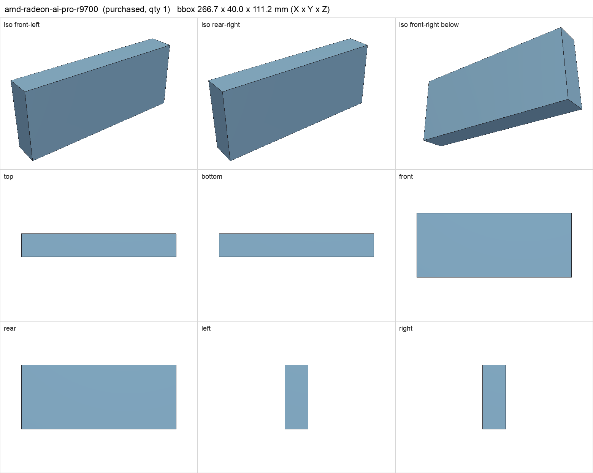

# AMD Radeon AI PRO R9700 32 GB (reference blower)

<!-- Generated by make check from part.toml. Edit part.toml, not this file. -->

| | |
| --- | --- |
| ID | `amd-radeon-ai-pro-r9700` |
| Category | purchased |
| Product | <https://www.amd.com/en/products/graphics/workstations/radeon-ai-pro/ai-9000-series/amd-radeon-ai-pro-r9700.html> |

Blower: air exits through the bracket. The dimension sheet found is PowerColor's, hosted by a retailer.
Occupies 3 positions (thickness plus a few mm air gap at the 20.32 mm pitch).
Running on an MCIO riser at x8; values marked review/listing are provisional.

## Used in

| Build | Qty | Status | Role |
| --- | ---: | --- | --- |
| [gpulab](../../../gpulab/parts/amd-radeon-ai-pro-r9700.md) | 1 | candidate | GPU under test (blower cooler), 3 baseboard positions |

## Model

- [amd-radeon-ai-pro-r9700.step](amd-radeon-ai-pro-r9700.step)
- Source: constructed. Body envelope only: length x height x thickness.
- Written by the `gpulab` build's generator

## Datasheets

- [AMD Radeon AI PRO R9700 specifications](https://www.amd.com/en/products/graphics/workstations/radeon-ai-pro/ai-9000-series/amd-radeon-ai-pro-r9700.html)
- [AI PRO R9700 spec sheet (PowerColor, retailer-hosted)](https://shop.captech.se/sv-SE/Product/158676/Link/89673/AI%20PRO%20R9700%20(1).pdf)
- Local copies: `datasheets/` after `make datasheets` (not committed)

## Dimensions

| Key | Value | Evidence | Source / note |
| --- | --- | --- | --- |
| length | 266.7 mm | datasheet | spec sheet |
| height | 111.2 mm | datasheet | spec sheet |
| thickness | 40 mm | datasheet | spec sheet; AMD: double slot |
| tgp | 300 W | datasheet | AMD TBP |
| mass | **unknown**  | unknown | not published |
| power_connector_from_tail | 0 mm | allowance | 12V-2x6 on the tail end (workstation blower), from product photos; 0 means on the tail end. Not measured |

## Interfaces

- requires `riser-x16-slot` value PCIe x16 count 1 (datasheet) — PCIe 5.0 x16 card on an x8 riser link
- requires `gpu-baseboard-position` count 3 (allowance)
- requires `12v-2x6` count 1 (datasheet) — 16-pin 12V-2x6
- requires `dc-power` load 300 load_limited 270 (datasheet) — stock board power, including the 75 W slot power drawn through the riser; capped to 270 W for the 2800 W PSU budget: rocm-smi -d <gpu> --setpoweroverdrive 270, set at boot and confirm the driver accepts it

