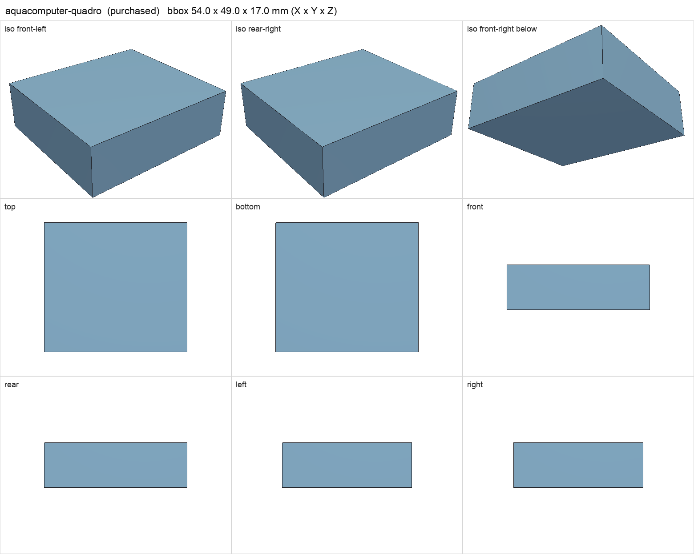

# Aquacomputer QUADRO fan controller (53256)

<!-- Generated by make check from part.toml. Edit part.toml, not this file. -->

| | |
| --- | --- |
| ID | `aquacomputer-quadro` |
| Category | purchased |
| Product | <https://shop.aquacomputer.de/Monitoring-and-Controlling/QUADRO-and-OCTO/QUADRO-fan-controller-for-PWM-fans::3773.html> |
| Linux_driver | <https://docs.kernel.org/hwmon/aquacomputer_d5next.html> |

Chosen 2026-11-06. Each output is rated 25 W, below the San Ace's 37.2 W, so
the QUADRO does not power the fan: the fused harness feeds the motor from the
PSU and only PWM, tach and ground go to a QUADRO channel. On Linux the
aquacomputer_d5next hwmon driver exposes writable pwm1-4 and fan tach; a host
service reads the hottest GPU (nvidia-smi) and writes the duty. If the PWM
line goes open the San Ace runs at 100% (catalog p.185 note), but a running
QUADRO holds its last duty if the host service dies: the service must set
100% on start, on exit and on any error, and stop GPU load if tach is lost.
Initial configuration software (aquasuite) is Windows-only; Linux control
needs no configuration. Whether its outputs float when unpowered is not
documented.

From the manual: power comes in on a 4-pin Molex (HDD) connector, pin 1 +12 V,
pins 2-3 GND, pin 4 +5 V; each fan output (pin 1 GND, 2 +12 V, 3 speed, 4 PWM)
supplies up to 2 A. Four 2-pin temperature sensor inputs (one 70 cm sensor,
53026, in the box). Configured once with aquasuite, it runs its fan modes on its
own: curve controllers (16 points) on the sensors wired to it; software and
virtual sensors need the PC running. "Hold minimum power" keeps fans turning at
0% demand. The USB connection is a 9-pin internal header. Ambient 10 to 40 C.
What the outputs do when a sensor fails is not documented.

## Used in

| Build | Qty | Status | Role |
| --- | ---: | --- | --- |
| [aipc](../../../aipc/parts/aquacomputer-quadro.md) | 1 | selected | PWM and tach for the V100 pressure fan, driven from GPU temperature by the host |
| [rack](../../../rack/parts/aquacomputer-quadro.md) | 1 | selected | fan controller: two outputs, one per bank, both on curves of the exhaust temperature |

## Model

- [aquacomputer-quadro.step](aquacomputer-quadro.step)
- Source: constructed. Case envelope only; rack is the only build that models it.
- Written by the `rack` build's generator

## Datasheets

- [QUADRO product page](https://shop.aquacomputer.de/Monitoring-and-Controlling/QUADRO-and-OCTO/QUADRO-fan-controller-for-PWM-fans::3773.html)
- [QUADRO manual (English, 2018-2024)](https://aquacomputer.de/tl_files/aquacomputer/downloads/manuals/QUADRO_english.pdf)
- [Linux aquacomputer_d5next hwmon driver](https://docs.kernel.org/hwmon/aquacomputer_d5next.html)
- Local copies: `datasheets/` after `make datasheets` (not committed)

## Dimensions

| Key | Value | Evidence | Source / note |
| --- | --- | --- | --- |
| channel_power | 25 W | datasheet | product page: max 25 W per channel |
| length | 54 mm | datasheet | manual 17.1: 54 x 49 x 17 mm |
| width | 49 mm | datasheet | manual 17.1: 54 x 49 x 17 mm |
| height | 17 mm | datasheet | manual 17.1: 54 x 49 x 17 mm |
| fan_output_current | 2 A | datasheet | manual 5.3: fan connector pin 2, 12 V / max. 2 A |
| ambient_max | 40 C | datasheet | manual 17.1: ambient 10 to 40 C |
| mass | 0.1 kg | assumed |  |

## Interfaces

- provides `fan-pwm-control` value 25 kHz PWM + tach, Linux hwmon count 4 (datasheet) — product page: four 4-pin PWM outputs with speed monitoring; kernel driver pwm writable
- provides `fan-header-4pin` value 12 V 4-pin PWM count 4 (datasheet) — the same four outputs as fan-pwm-control, used as full fan headers: 12 V at up to 2 A each (manual 5.3)
- provides `aquacomputer-temp-input` value Aqua Computer 2-pin temperature sensor count 4 (datasheet) — manual 5.7: compatible sensors 53066, 53067, 53147, 53025, 53026
- requires `usb2-header` count 1 (datasheet) — internal USB 2.0 header; cable about 100 cm included
- requires `dc-power` load 2 (assumed)

