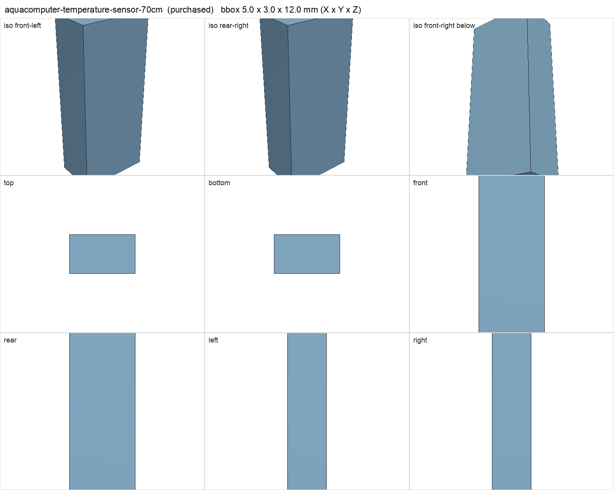

# Aqua Computer temperature sensor 70 cm (art. 53026)

<!-- Generated by make check from part.toml. Edit part.toml, not this file. -->

| | |
| --- | --- |
| ID | `aquacomputer-temperature-sensor-70cm` |
| Category | purchased |
| Product | <https://shop.aquacomputer.de/Ueberwachung-und-Steuerung/Sensoren/Temperatursensor-70-cm::1621.html> |

Flat air or surface sensor on a lead with a 2-pin plug; one comes with every QUADRO
(manual: replacement part no. 53026). Total length about 70 cm including sensor and
plug. A thicker third-party plug may not fit beside the QUADRO's other sensor inputs.

## Used in

| Build | Qty | Status | Role |
| --- | ---: | --- | --- |
| [rack](../../../rack/parts/aquacomputer-temperature-sensor-70cm.md) | 1 | selected | exhaust air temperature, the input to both fan curves |

## Model

- [aquacomputer-temperature-sensor-70cm.step](aquacomputer-temperature-sensor-70cm.step)
- Source: constructed. Sensor tip envelope only; the lead is not modeled.
- Written by the `rack` build's generator

## Datasheets

- [QUADRO manual: scope of delivery and compatible sensors](https://aquacomputer.de/tl_files/aquacomputer/downloads/manuals/QUADRO_english.pdf)
- Local copies: `datasheets/` after `make datasheets` (not committed)

## Dimensions

| Key | Value | Evidence | Source / note |
| --- | --- | --- | --- |
| cable_length | 700 mm | listing | Aqua Computer shop: about 70 cm total, sensor and connector included |
| tip_length | 12 mm | allowance | sensor head not dimensioned by Aqua Computer |
| tip_width | 5 mm | allowance | sensor head not dimensioned by Aqua Computer |
| tip_thickness | 3 mm | allowance | sensor head not dimensioned by Aqua Computer |
| mass | 0.01 kg | assumed |  |

## Interfaces

- requires `aquacomputer-temp-input` value Aqua Computer 2-pin temperature sensor count 1 (datasheet)

