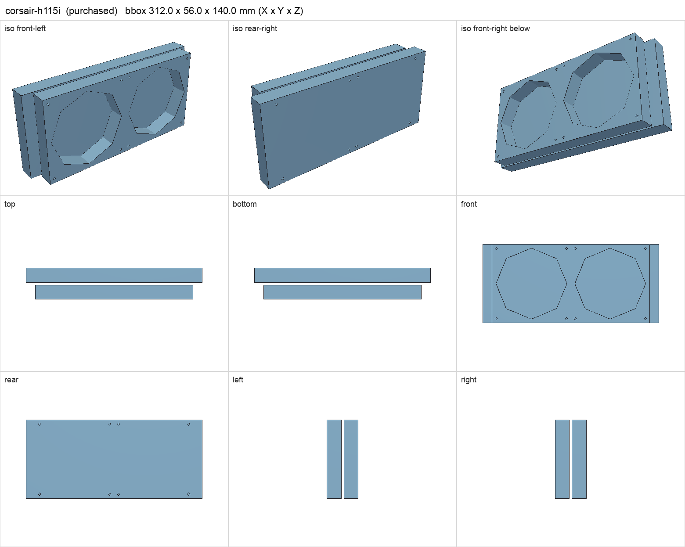

# Corsair Hydro H115i 280 mm AIO (reused)

<!-- Generated by make check from part.toml. Edit part.toml, not this file. -->

| | |
| --- | --- |
| ID | `corsair-h115i` |
| Category | purchased |

The retail H115i mounting kit covers Intel and desktop AMD sockets only. On
the EPYC it mounts with a separate TR4/SP3 bracket (asetek-tr4-bracket). The
round cold plate covers only part of the SP3 heat spreader; the owner accepted
that on 2026-11-06.

## Used in

| Build | Qty | Status | Role |
| --- | ---: | --- | --- |
| [aipc](../../../aipc/parts/corsair-h115i.md) | 1 | owned | Berserk CPU cooler, front of shelf |

## Model

- [corsair-h115i.step](corsair-h115i.step)
- Source: constructed. Radiator and fan envelopes; owner measured the front bracket overhang only.
- Written by the `aipc` build's generator

## Datasheets

- None recorded. Reused unit; exact revision not recorded. Add the Corsair spec sheet for that revision.

## Dimensions

| Key | Value | Evidence | Source / note |
| --- | --- | --- | --- |
| radiator_length | 312 mm | assumed |  |
| radiator_thickness | 26 mm | assumed |  |
| radiator_height | 140 mm | assumed |  |
| fan_size | 140 mm | standard | 140 mm PC fan standard |
| fan_depth | 25 mm | standard | 140 x 25 mm fan |
| hole_pitch | 124.5 mm | standard | 140 mm fan hole pattern |
| mass | 1.3 kg | assumed |  |

## Interfaces

- provides `cooler-mount` accepts ['LGA115x', 'LGA1366', 'LGA2011', 'AM2', 'AM3', 'FM2'] (assumed) — retail kit only; SP3 comes from asetek-tr4-bracket
- provides `aio-pump-mount` value Asetek round pump count 1 (assumed) — confirm the bracket lists this pump revision
- requires `radiator-mount` value 280 mm, 124.5 mm pitch count 2 (assumed)
- requires `dc-power` load 12 (assumed)

