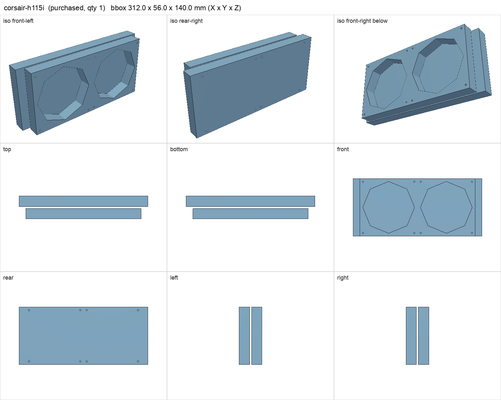
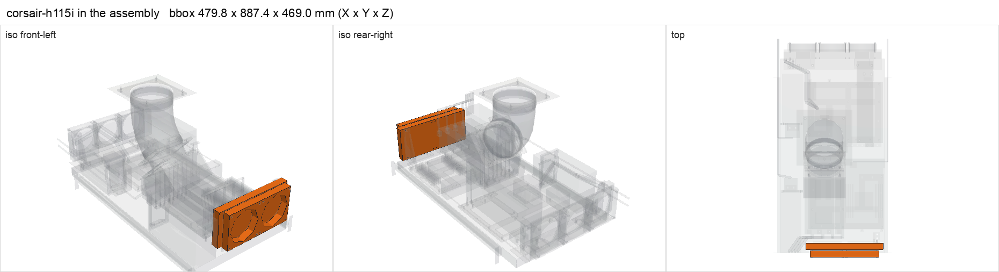

# Corsair Hydro H115i 280 mm AIO (reused)

<!-- Generated by make check from part.toml. Edit part.toml, not this file. -->

| | |
| --- | --- |
| ID | `corsair-h115i` |
| Category | purchased |
| Role | Berserk CPU cooler, front of shelf |
| Status | owned |
| Quantity | 1 |
| Systems | berserk |

The retail H115i mounting kit covers Intel and desktop AMD sockets only.
EPYC SP3 needs a separate bracket that is not in the parts list, and the
round cold plate covers only part of the SP3 heat spreader.

## Model

- [corsair-h115i.step](corsair-h115i.step)
- Source: constructed. Radiator and fan envelopes; owner measured the front bracket overhang only.
- Assembly: 2 instances in the assembly

## Datasheets

- None recorded. Reused unit; exact revision not recorded. Add the Corsair spec sheet for that revision.

## Dimensions

| Key | Value | Evidence | Source / note |
| --- | --- | --- | --- |
| radiator_length | 312 mm | assumed |  |
| radiator_thickness | 26 mm | assumed |  |
| radiator_height | 140 mm | assumed |  |
| fan_size | 140 mm | standard | 140 mm PC fan standard |
| fan_depth | 25 mm | standard | 140 x 25 mm fan |
| hole_pitch | 124.5 mm | standard | 140 mm fan hole pattern |
| mass | 1.3 kg | assumed |  |

## Interfaces

- provides `cooler-mount` accepts ['LGA115x', 'LGA1366', 'LGA2011', 'AM2', 'AM3', 'FM2'] (assumed) — retail kit; no SP3/TR4 bracket recorded
- requires `radiator-mount` value 280 mm, 124.5 mm pitch count 2 (assumed)
- requires `dc-power` load 12 (assumed)

## Compatibility checks

| Status | Rule | Interface | Detail |
| --- | --- | --- | --- |
| FAIL | value | `cooler-mount` | amd-epyc-7702p needs SP3; providers offer ['LGA115x, LGA1366, LGA2011, AM2, AM3, FM2'] |
| BLOCKED | budget | `shelf-load` | load 23.1 kg of 39.0 kg x derate 1.0 = 39.0 kg (59% of rating); unknown load for ['fan-controller'] |
| provisional | budget | `dc-power` | load 1090.2 W of 1600.0 W x derate 0.8 = 1280.0 W (68% of rating); relies on configured limits of ['nvidia-v100-pcie-16gb']; unlimited peak 1370.2 W |
| provisional | value | `radiator-mount` | corsair-h115i needs 280 mm, 124.5 mm pitch; provided by fan140_aio_frame |
| provisional | count | `radiator-mount` | need 2 x radiator-mount=280 mm, 124.5 mm pitch, have 2 |

