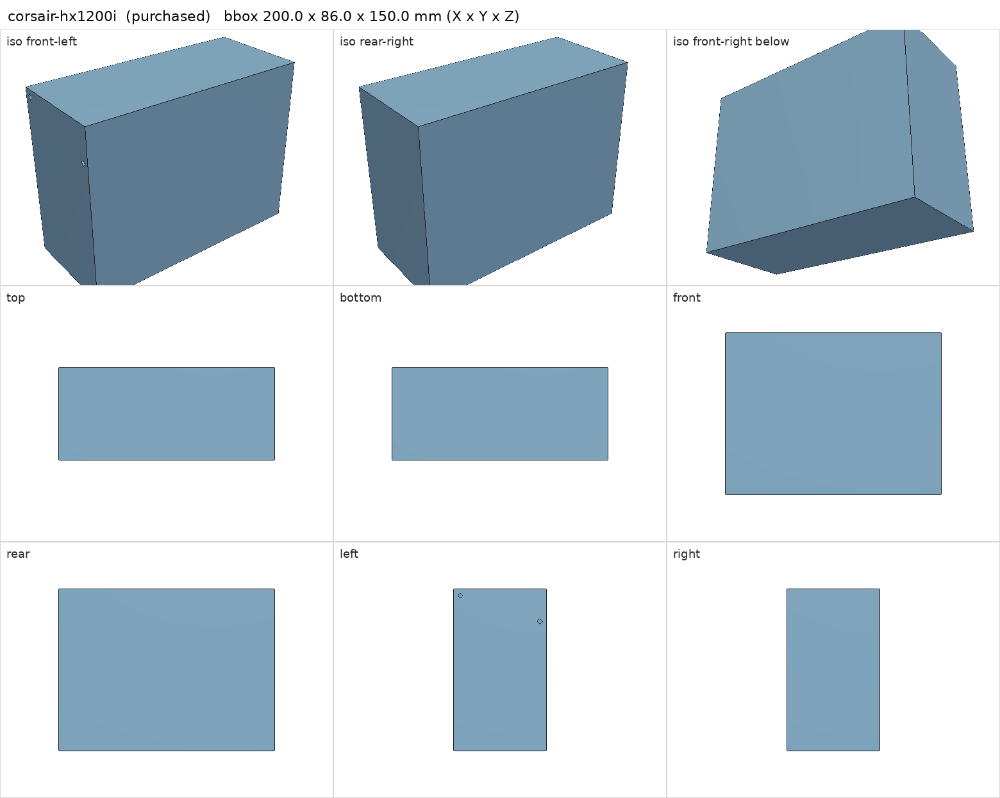

# Corsair HX1200i PSU

<!-- Generated by make check from part.toml. Edit part.toml, not this file. -->

| | |
| --- | --- |
| ID | `corsair-hx1200i` |
| Category | purchased |

## Used in

| Build | Qty | Status | Role |
| --- | ---: | --- | --- |
| [aipc](../../../aipc/parts/corsair-hx1200i.md) | 1 | owned | Kenshin PSU |

## Model

- [corsair-hx1200i.step](corsair-hx1200i.step)
- Source: constructed
- Written by the `aipc` build's generator

## Datasheets

- None recorded. Revision not recorded: the 2017 HX1200i (CP-9020070, 200 mm) has no 12V-2x6 cable; the 2023 ATX 3.x unit (CP-9020281) has one. Record the label and add its spec sheet.

## Dimensions

| Key | Value | Evidence | Source / note |
| --- | --- | --- | --- |
| width | 150 mm | standard | ATX PSU face 150 x 86 |
| height | 86 mm | standard | ATX PSU face 150 x 86 |
| depth | 200 mm | assumed |  |
| mass | 2.4 kg | assumed |  |

## Interfaces

- provides `dc-power` capacity 1200 W (listing)
- provides `atx-24pin` count 1 (assumed)
- provides `eps-8pin-cpu` count 2 (assumed)
- provides `12v-2x6` value 12V-2x6 count **unknown** (assumed) — depends on PSU revision; a Corsair Type-4 12VHPWR cable may be needed
- requires `psu-restraint` value ATX 150 x 86 face count 1 (assumed)
- requires `ac-power` load 1009 W (allowance) — Kenshin DC peak 908 W / ~0.9 efficiency

