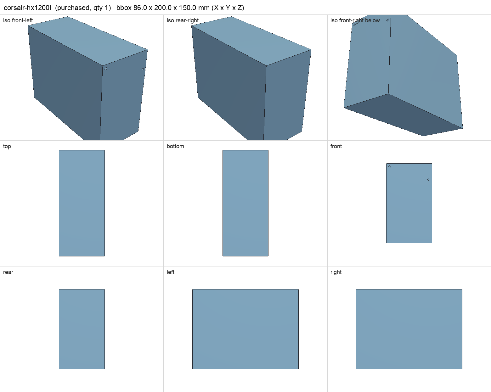
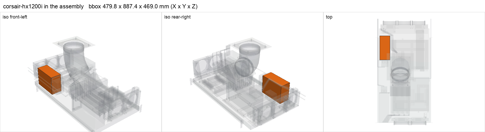

# Corsair HX1200i PSU

<!-- Generated by make check from part.toml. Edit part.toml, not this file. -->

| | |
| --- | --- |
| ID | `corsair-hx1200i` |
| Category | purchased |
| Role | Kenshin PSU |
| Status | owned |
| Quantity | 1 |
| Systems | kenshin |

## Model

- [corsair-hx1200i.step](corsair-hx1200i.step)
- Source: constructed
- Assembly: 1 instances in the assembly

## Datasheets

- None recorded. Revision not recorded: the 2017 HX1200i (CP-9020070, 200 mm) has no 12V-2x6 cable; the 2023 ATX 3.x unit (CP-9020281) has one. Record the label and add its spec sheet.

## Dimensions

| Key | Value | Evidence | Source / note |
| --- | --- | --- | --- |
| width | 150 mm | standard | ATX PSU face 150 x 86 |
| height | 86 mm | standard | ATX PSU face 150 x 86 |
| depth | 200 mm | assumed |  |
| mass | 2.4 kg | assumed |  |

## Interfaces

- provides `dc-power` capacity 1200 W (listing)
- provides `atx-24pin` count 1 (assumed)
- provides `eps-8pin-cpu` count 2 (assumed)
- provides `gpu-power` value 12V-2x6 count **unknown** (assumed) — depends on PSU revision; a Corsair Type-4 12VHPWR cable may be needed
- requires `psu-restraint` value ATX 150 x 86 face count 1 (assumed)
- requires `ac-power` load 1009 W (allowance) — Kenshin DC peak 908 W / ~0.9 efficiency

## Compatibility checks

| Status | Rule | Interface | Detail |
| --- | --- | --- | --- |
| BLOCKED | budget | `ac-power` | load 2531.0 W; capacity unknown |
| BLOCKED | count | `gpu-power` | need 1 x gpu-power=12v-2x6, have None |
| BLOCKED | budget | `shelf-load` | load 23.2 kg of 39.0 kg x derate 1.0 = 39.0 kg (59% of rating); unknown load for ['fan-controller'] |
| provisional | count | `atx-24pin` | need 1 x atx-24pin, have 1 |
| provisional | budget | `dc-power` | load 908.0 W of 1200.0 W x derate 0.8 = 960.0 W (76% of rating) |
| provisional | count | `eps-8pin-cpu` | need 2 x eps-8pin-cpu, have 2 |
| provisional | value | `gpu-power` | zotac-rtx-5090-solid needs 12V-2x6; provided by corsair-hx1200i |
| provisional | value | `psu-restraint` | corsair-hx1200i needs ATX 150 x 86 face; provided by psu_bracket |
| provisional | count | `psu-restraint` | need 2 x psu-restraint=atx 150 x 86 face, have 2 |

