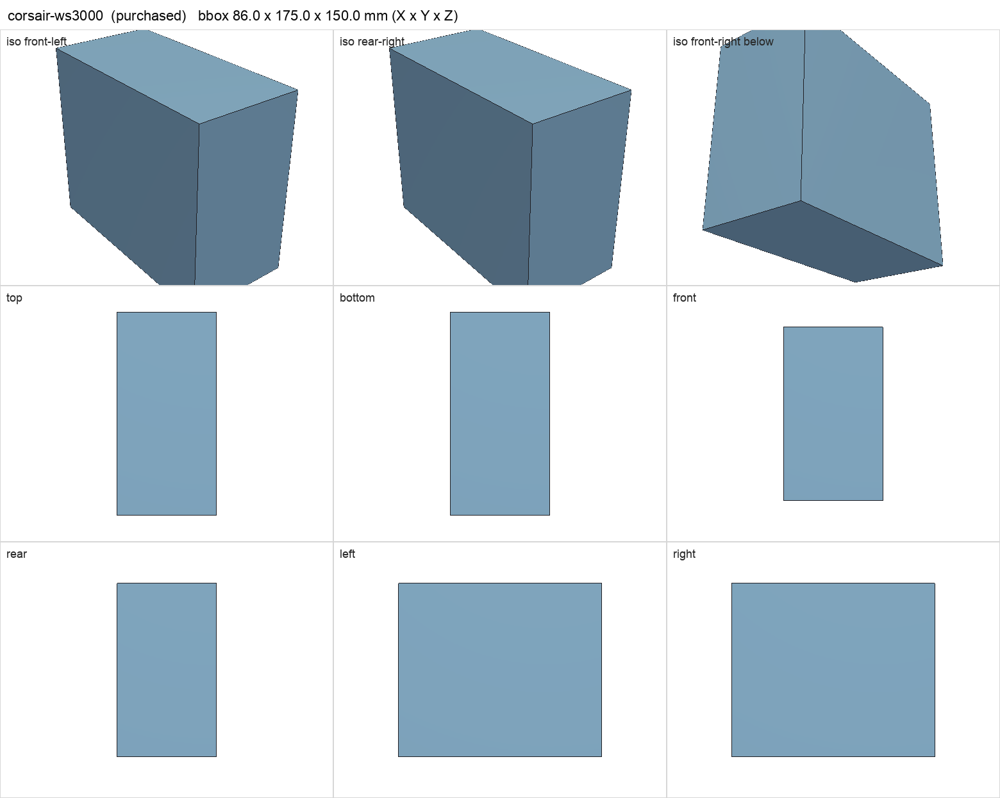

# Corsair WS3000 3000 W ATX 3.1 workstation PSU (CP-9020312)

<!-- Generated by make check from part.toml. Edit part.toml, not this file. -->

| | |
| --- | --- |
| ID | `corsair-ws3000` |
| Category | purchased |
| Product | <https://www.corsair.com/us/en/p/psu/cp-9020312-na/ws3000-3000w-atx-3-1-fully-modular-workstation-power-supply-cp-9020312-na> |
| Explainer | <https://www.corsair.com/explorer/diy-builder/power-supply-units/corsair-ws3000-everything-you-need-to-know/> |

220-240 V AC only (16 A, 47-63 Hz) with a C19 inlet; not for 110/120 V outlets.
Fully modular, 140 mm fan without a zero-RPM mode, 80 PLUS Platinum (230 V EU),
rated continuously at 40 C, 10-year warranty, no iCUE monitoring.
The PCIe outputs are four dual cables: 6+2 at 600 mm, a second 6+2 150 mm further.
The rear-face screw pattern is not published; ATX is assumed.

## Used in

| Build | Qty | Status | Role |
| --- | ---: | --- | --- |
| [gpulab](../../../gpulab/parts/corsair-ws3000.md) | 1 | selected | node PSU: board, CPU, GPUs and riser boards |

## Model

- [corsair-ws3000.step](corsair-ws3000.step)
- Source: constructed
- Written by the `gpulab` build's generator

## Datasheets

- [Corsair WS3000: everything you need to know (spec and cable tables)](https://www.corsair.com/explorer/diy-builder/power-supply-units/corsair-ws3000-everything-you-need-to-know/)
- [Corsair WS3000 product page](https://www.corsair.com/us/en/p/psu/cp-9020312-na/ws3000-3000w-atx-3-1-fully-modular-workstation-power-supply-cp-9020312-na)
- Local copies: `datasheets/` after `make datasheets` (not committed)

## Dimensions

| Key | Value | Evidence | Source / note |
| --- | --- | --- | --- |
| width | 150 mm | datasheet | Corsair: 175 x 150 x 86 mm (L x W x H) |
| height | 86 mm | datasheet | Corsair: 175 x 150 x 86 mm (L x W x H) |
| depth | 175 mm | datasheet | Corsair: 175 x 150 x 86 mm (L x W x H) |
| mass | 4.465 kg | listing | Computer Lounge NZ listing, CP-9020312-WW |
| cable_atx24_length | 610 mm | datasheet | Corsair cable table, +/-10 mm |
| cable_eps_length | 650 mm | datasheet | Corsair cable table, +/-10 mm |
| cable_12v_2x6_length | 675 mm | datasheet | Corsair cable table, +/-10 mm |
| cable_pcie_length | 750 mm | datasheet | Corsair cable table: dual 6+2, 600 mm to the first connector and 150 mm more to the second |
| cable_pcie_first_connector | 600 mm | datasheet | Corsair cable table, connector spacing 600 + 150 mm |

## Interfaces

- provides `dc-power` capacity 3000 W (datasheet) — +12 V 250 A
- provides `atx-24pin` count 1 (datasheet)
- provides `eps-8pin-cpu` count 2 (datasheet) — 4+4 pin
- provides `12v-2x6` count 4 (datasheet) — four native cables, 600 W each
- provides `pcie-8pin` count 8 (datasheet) — 6+2 pin, two per cable on four cables
- provides `sata-power` count 9 (datasheet)
- provides `peripheral-12v` count 6 (datasheet) — Molex (PATA), three per cable on two cables
- requires `ac-power` load 3260 W (allowance) — 3.0 kW output / ~0.92 Platinum efficiency at full load

